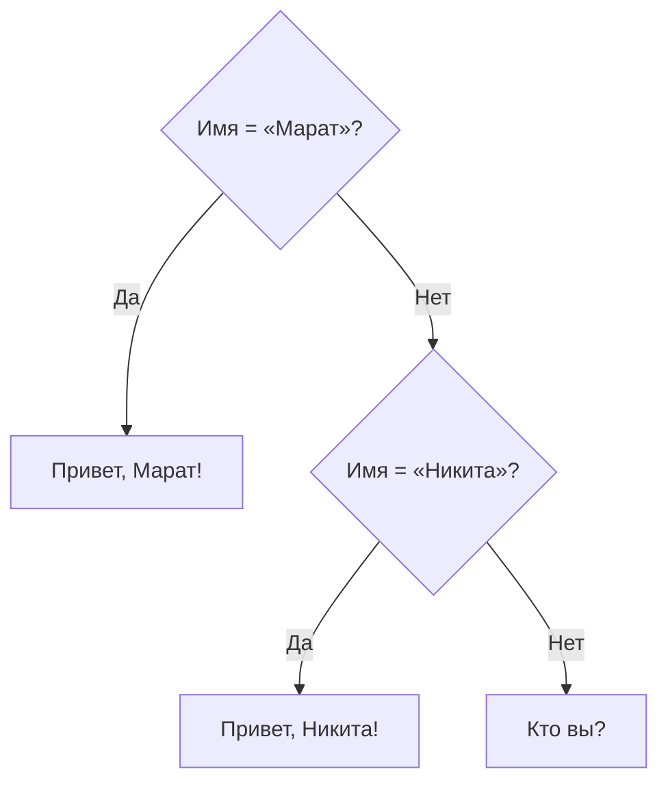

---
tags:
  - 1С/программирование
---

> [!abstract] Коротко
> `Если … Тогда … ИначеЕсли … Тогда … Иначе … КонецЕсли;` — выполняется первая истинная ветка. Для выбора одного из двух значений — тернарный оператор `?(Условие, ЗначениеДа, ЗначениеНет)`. Условия с `И`/`ИЛИ` вычисляются сокращённо — защитную проверку ставим первой.

## Зачем нужно условие

Программа не всегда должна делать одно и то же. Если товара нет на складе — продавать нельзя; если сумма больше 10 000 — даём скидку. Для таких развилок используется конструкция **`Если`**. Она бывает трёх видов — от простой к сложной.

### 1. Одна ветка: «если — сделай»

```1C
ИмяСотрудника = "Марат";

Если ИмяСотрудника = "Марат" Тогда
	Сообщить("Привет, Марат");
КонецЕсли;
```

Разбор:
- `Если` … `Тогда` — между ними **условие**: выражение, результат которого `Истина` или `Ложь` ([[07. Работа с булевым типом]]).
- Строки между `Тогда` и `КонецЕсли` выполнятся **только если условие истинно**. Если ложно — блок просто пропускается, и программа идёт дальше.
- `КонецЕсли;` закрывает конструкцию — после него обязательно `;`.

Результат: `Привет, Марат`. Если поменять имя на `"Никита"`, ничего не выведется.

### 2. Две ветки: «если — иначе»

```1C
ИмяСотрудника = "Никита";

Если ИмяСотрудника = "Марат" Тогда
	Сообщить("Привет, Марат");
Иначе
	Сообщить("Кто вы?");
КонецЕсли;
```

Ветка `Иначе` выполняется, когда условие **ложно**. Из двух веток всегда выполнится ровно одна. Результат: `Кто вы?`.

### 3. Несколько веток: «если — иначе если — иначе»

```1C
ИмяСотрудника = "Никита";

Если ИмяСотрудника = "Марат" Тогда
	Сообщить("Привет, Марат!");
ИначеЕсли ИмяСотрудника = "Никита" Тогда
	Сообщить("Привет, Никита!");
Иначе
	Сообщить("Кто вы?");
КонецЕсли;
```

Условия проверяются **сверху вниз**. Как только нашлось первое истинное, выполняется его ветка, а остальные пропускаются — даже если они тоже истинны. Если ни одно не подошло, выполняется `Иначе` (её можно не писать). Результат: `Привет, Никита!`.



> [!tip] Шаблон вместо ручного ввода
> Наберите в модуле `Если` и нажмите `Ctrl+Q` (или выберите шаблон из подсказки) — Конфигуратор вставит заготовку `Если … Тогда … КонецЕсли;`.

> [!warning] Частые ошибки новичка
> - Забыли `Тогда` после условия или `;` после `КонецЕсли`.
> - Написали `ИначеЕсли` раздельно (`Иначе Если`) — это уже **вложенное** условие, которому нужен свой `КонецЕсли`.
> - Расположили ветки так, что общая стоит выше частной: `Если Сумма > 1000 … ИначеЕсли Сумма > 5000` — вторая ветка не выполнится никогда, ведь 5000+ уже попало в первую.

## Условное выражение

Если нужно выбрать одно из двух значений, можно использовать `?()`:
```1C
Количество = 3;
ТекстНаличия = ?(Количество > 0, "Есть в наличии", "Нет в наличии");
```

Первый параметр — условие, второй — результат при `Истина`, третий — результат при `Ложь`. Здесь `ТекстНаличия` получит `"Есть в наличии"`. Вычисляется только выбранная ветка.

Это короткая запись для случая «выбрать одно из двух значений». Если в ветках нужно **выполнить действия** (вывести сообщение, записать объект), используем обычный `Если`.

## Короткое вычисление условий

Условия с `И` и `Или` вычисляются слева направо. Если результат уже известен, оставшаяся часть не вычисляется:
```1C
Если Количество <> 0 И Сумма / Количество > 100 Тогда
	Сообщить("Средняя цена больше 100");
КонецЕсли;
```

При нулевом количестве деление не выполняется, поэтому ошибки деления на ноль не будет. Проверку, которая защищает следующее действие, ставим первой.

Операторы имеют приоритет: сначала `Не`, потом `И`, потом `Или`. Если условие сложное, используем скобки, чтобы его смысл был очевиден.

> [!question]- Проверь себя
> 1. Сколько веток выполнится, если истинны и `Если`, и `ИначеЕсли`?
> 2. Запишите выбор текста «Есть»/«Нет» по количеству одной строкой.
> 3. Как избежать деления на ноль в условии `Сумма / Количество > 100`?
>
> > [!success]- Ответы
> > 1. Одна — первая истинная.
> > 2. `Текст = ?(Количество > 0, "Есть", "Нет");`
> > 3. Поставить первой проверку: `Количество <> 0 И Сумма / Количество > 100`.

%% навигация %%

---
← [[02. Программирование/09. Процедуры и функции|09. Процедуры и функции]] · [[02. Программирование/00. Навигация по разделу|↑ Раздел]] · [[00. Оглавление|⌂ Оглавление]] · [[02. Программирование/11. Блок цикла|11. Блок цикла]] →
