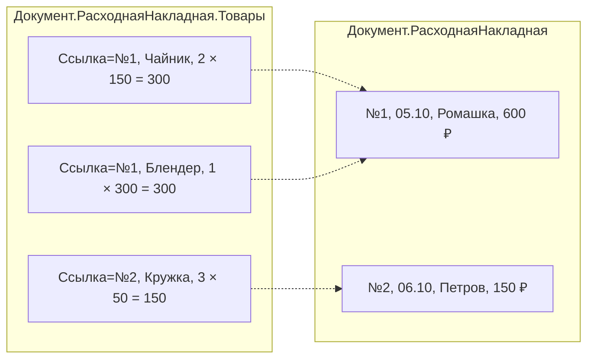

---
tags:
  - 1С/запросы
---

> [!abstract] Коротко
> Шапка документа и его табличная часть — **разные таблицы**. В `Документ.….Товары` поле `Ссылка` — документ-владелец строки, через него доступны реквизиты шапки (`Т.Ссылка.Дата`). Главная ловушка: суммировать реквизит шапки по строкам — итог умножится на число строк.

## Шапка и строки — две разные таблицы

Откройте любую накладную в 1С:Предприятии. Вверху — **шапка**: номер, дата, покупатель, итоговая сумма. Внизу — **табличная часть**: строки товаров. В базе это хранится в **двух разных таблицах**:



| Таблица | Одна строка — это | Строк в примере |
| --- | --- | --- |
| `Документ.РасходнаяНакладная` | Одна накладная | 2 |
| `Документ.РасходнаяНакладная.Товары` | Одна строка товара какой-то накладной | 3 |

Каждая строка табличной части «знает», какой накладной она принадлежит: у неё есть поле **`Ссылка`** — ссылка на документ-владелец.

## Строки одной накладной

```1C
ВЫБРАТЬ
    Т.Ссылка КАК Накладная,
    Т.НомерСтроки КАК НомерСтроки,
    Т.Товар КАК Товар,
    Т.Количество КАК Количество,
    Т.Цена КАК Цена,
    Т.Сумма КАК Сумма
ИЗ
    Документ.РасходнаяНакладная.Товары КАК Т
ГДЕ
    Т.Ссылка = &Накладная
УПОРЯДОЧИТЬ ПО
    Т.НомерСтроки
```

| Поле | Что это |
| --- | --- |
| `Т.Ссылка` | Документ, которому принадлежит строка (**не** товар!) |
| `Т.НомерСтроки` | Номер строки в табличной части: 1, 2, 3… |
| `Т.Товар`, `Т.Количество`, `Т.Цена`, `Т.Сумма` | Реквизиты табличной части, которые мы создали в разделе 01 |

В параметр `&Накладная` передаём ссылку на документ:

```1C
Запрос.УстановитьПараметр("Накладная", СсылкаНаНакладную);
```

Для накладной №1 из схемы выше получим 2 строки: Чайник и Блендер.

> [!warning] `Ссылка` ≠ `Товар`
> Новички часто думают, что `Т.Ссылка` — это ссылка на товар строки. Нет: это ссылка на **документ**. Товар лежит в поле `Т.Товар`.

## Добавим данные шапки

Через поле `Ссылка` можно дотянуться до реквизитов шапки — так же, как в прошлом уроке мы шли от покупателя к его наименованию:

```1C
ВЫБРАТЬ
    Т.Ссылка.Дата КАК Дата,
    Т.Ссылка.Покупатель КАК Покупатель,
    Т.Товар КАК Товар,
    Т.Сумма КАК Сумма
ИЗ
    Документ.РасходнаяНакладная.Товары КАК Т
ГДЕ
    Т.Ссылка.Проведен
```

Результат для примера:

| Дата | Покупатель | Товар | Сумма |
| --- | --- | --- | --- |
| 05.10 | Ромашка | Чайник | 300 |
| 05.10 | Ромашка | Блендер | 300 |
| 06.10 | Петров | Кружка | 150 |

Дата и покупатель первой накладной **повторились дважды** — по одному разу на каждую её строку. Это нормально: одна строка результата = одна строка товара.

## Главная ловушка: итог шапки в строках

Задача: «посчитать выручку по накладным». Неправильное решение — взять `Т.Ссылка.ИтоговаяСумма` из таблицы строк и сложить:

| Товар | Т.Ссылка.ИтоговаяСумма |
| --- | --- |
| Чайник | 600 |
| Блендер | 600 |
| Кружка | 150 |
| **Сумма** | **1350** ✗ |

Правильный ответ — 750 (600 + 150). Итог первой накладной посчитался **дважды**, потому что у неё две строки. Как правильно:

| Что нужно | Откуда брать |
| --- | --- |
| Сумма по строкам товаров | `СУММА(Т.Сумма)` из таблицы **строк** |
| Сумма по документам целиком | `СУММА(Н.ИтоговаяСумма)` из таблицы **шапок** |

> [!tip] Правило
> Реквизиты шапки суммируем только в таблице шапок. В таблице строк шапка повторяется столько раз, сколько у документа строк.

## Через конструктор

1. В левом списке раскрываем **Документы → РасходнаяНакладная**. Под документом видна его табличная часть **Товары** — выбираем именно её.
2. Переносим поля `Ссылка`, `НомерСтроки`, `Товар`, `Количество`, `Сумма`.
3. Чтобы добавить поле шапки, раскрываем у табличной части поле `Ссылка` (значок «+») — внутри реквизиты документа: `Дата`, `Покупатель`…
4. На вкладке **Условия** добавляем `Ссылка = &Накладная`.
5. На вкладке **Порядок** — `НомерСтроки`.

![[07-Табличная-часть-в-конструкторе.png]]

*Конструктор: слева у документа `РасходнаяНакладная` видна табличная часть `Товары`; в центре она выбрана, и у её поля `Ссылка` раскрыты реквизиты шапки. Справа — поля строки и два поля шапки через `Ссылка`: `Ссылка.Дата` и `Ссылка.Договор`.*

## Проверка

1. Накладная с двумя товарами → запрос по её ссылке возвращает 2 строки.
2. Накладная только с услугами (пустая табличная часть «Товары») → **0 строк**, хотя сам документ существует.
3. Сравните `СУММА(Т.Ссылка.ИтоговаяСумма)` по строкам и `СУММА(Н.ИтоговаяСумма)` по шапкам — убедитесь, что первое завышено.

> [!question]- Проверь себя
> 1. Что содержит поле `Ссылка` таблицы `Документ.РасходнаяНакладная.Товары`?
> 2. Почему `СУММА(Т.Ссылка.ИтоговаяСумма)` даёт завышенный результат?
> 3. Сколько строк вернёт запрос к табличной части документа без товаров?
>
> > [!success]- Ответы
> > 1. Ссылку на документ, которому принадлежит строка.
> > 2. Сумма шапки повторяется в каждой строке товаров.
> > 3. Ноль.

%% навигация %%

---
← [[03. Язык запросов и СКД/06. Ссылки, иерархия и составные типы|06. Ссылки, иерархия и составные типы]] · [[03. Язык запросов и СКД/00. Навигация по разделу|↑ Раздел]] · [[00. Оглавление|⌂ Оглавление]] · [[03. Язык запросов и СКД/08. Соединения таблиц|08. Соединения таблиц]] →
