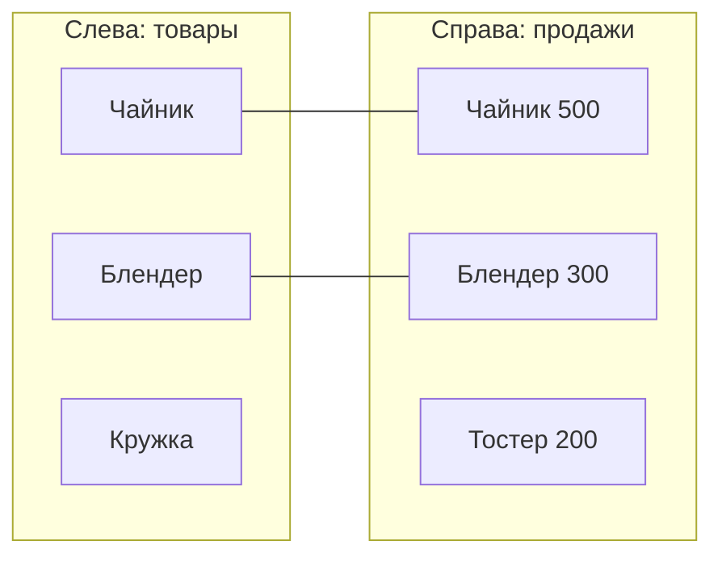

---
tags:
  - 1С/запросы
---

> [!abstract] Коротко
> **Соединение** сопоставляет строки двух таблиц по условию `ПО` и добавляет колонки. Внутреннее — только совпавшие, левое — все слева + найденные справа (у ненайденных `NULL`), полное — все с обеих сторон. Если справа несколько совпадений, строки **размножаются**: 2 × 3 = 6. Перед соединением приводим таблицы к одной детализации.

## Зачем соединять таблицы

До сих пор каждый запрос брал данные из **одной** таблицы. Но часто ответ собирается из двух. Задача: «покажи **все** товары и выручку по каждому за октябрь». Товары лежат в справочнике, выручка — в регистре продаж. Нужно поставить их рядом: к каждой строке справочника приписать строку продаж того же товара. Это и есть **соединение**.

Аналогия: у вас два списка — список сотрудников и список телефонов «фамилия → номер». Соединение — это когда к каждой фамилии из первого списка вы приписываете номер из второго, сопоставляя по фамилии.

## Учебные данные

Будем разбирать на маленьких таблицах:

**Слева — справочник товаров:**

| Товар |
| --- |
| Чайник |
| Блендер |
| Кружка |

**Справа — продажи за октябрь (обороты):**

| Номенклатура | Выручка |
| --- | --- |
| Чайник | 500 |
| Блендер | 300 |
| Тостер | 200 |

Кружку в октябре не продавали. Тостер продавали, но (допустим) его уже удалили из нашего списка слева.

## Четыре вида соединения

Условие сопоставления у всех одно — «товар слева = номенклатура справа». Отличаются они тем, что делать со строками, **не нашедшими пару**.

| Вид | Что останется | Результат на наших данных |
| --- | --- | --- |
| **Внутреннее** | Только строки, у которых нашлась пара | Чайник 500, Блендер 300 |
| **Левое** | **Все** строки слева; справа — найденная пара или `NULL` | Чайник 500, Блендер 300, Кружка `NULL` |
| **Правое** | Все строки справа; слева — пара или `NULL` | Чайник 500, Блендер 300, `NULL` 200 (Тостер) |
| **Полное** | Все строки с обеих сторон | Чайник, Блендер, Кружка `NULL`, `NULL` Тостер 200 |



На практике чаще всего нужны **левое** («все из главного списка, плюс что нашлось») и **внутреннее** («только то, что есть в обоих»). Правое соединение — то же левое, только таблицы переставлены местами; обычно пишут левое.

`NULL` в результате означает «пары не нашлось, значения нет». Что с ним делать — в [[09. NULL и отсутствующие значения]].

## Пример: все товары с выручкой

```1C
ВЫБРАТЬ
    Н.Ссылка КАК Товар,
    ЕСТЬNULL(П.СуммаОборот, 0) КАК Выручка
ИЗ
    Справочник.Номенклатура КАК Н
    ЛЕВОЕ СОЕДИНЕНИЕ РегистрНакопления.Продажи.Обороты(&Начало, &Конец, , ) КАК П
    ПО Н.Ссылка = П.Номенклатура
ГДЕ
    НЕ Н.ЭтоГруппа
    И НЕ Н.ПометкаУдаления
```

Разберём:

| Часть | Смысл |
| --- | --- |
| `Справочник.Номенклатура КАК Н` | Левая таблица — **главная**: все её строки останутся |
| `ЛЕВОЕ СОЕДИНЕНИЕ … КАК П` | Правая таблица — обороты продаж за период |
| `ПО Н.Ссылка = П.Номенклатура` | Условие сопоставления: товар справочника = товар в продажах |
| `ЕСТЬNULL(П.СуммаОборот, 0)` | Если пары нет (`NULL`), показать 0 |

Конец периода передаём с временем конца дня (`КонецДня(...)`, см. [[05. Параметры и границы периода]]).

Сопоставляем **по ссылкам**, а не по названиям: `Н.Наименование = П.Номенклатура.Наименование` склеит разные товары с одинаковым названием.

## Главная опасность: строки размножаются

Если для одной строки слева нашлось **несколько** пар справа, в результате будет несколько строк — по одной на каждую пару.

Пусть продажи справа разбиты по покупателям:

| Номенклатура | Контрагент | Выручка |
| --- | --- | --- |
| Чайник | Ромашка | 300 |
| Чайник | Петров | 200 |

Соединяем с таблицей, где у чайника **две** строки (например, две цены поставщиков):

| Товар | Поставщик |
| --- | --- |
| Чайник | Альфа |
| Чайник | Бета |

Результат — 2 × 2 = **4 строки**, и выручка 300 и 200 встретится по **два** раза. Сумма выручки станет 1000 вместо 500.

> [!warning] Перед соединением спросите себя
> «Сколько строк справа может подойти к одной строке слева?» Если больше одной — результат размножится. Чтобы получить «одна строка на товар», правую таблицу сначала **сворачивают** до одной строки на товар: группировкой во вложенном запросе ([[14. Вложенные запросы]]) или временной таблицей ([[15. Временные таблицы и пакеты запросов]]).

## Условие в `ПО` или в `ГДЕ`?

Пример: нужны все товары, но с выручкой только от покупателя «Ромашка».

Если написать условие на правую таблицу в `ГДЕ`:

```1C
ГДЕ П.Контрагент = &Ромашка
```

то строки товаров **без продаж** (там `П.Контрагент` = `NULL`) не пройдут условие и пропадут. Левое соединение фактически превратится во внутреннее.

Правильно — ограничить правую таблицу **до** соединения: в параметрах виртуальной таблицы или в `ПО`:

```1C
ЛЕВОЕ СОЕДИНЕНИЕ РегистрНакопления.Продажи.Обороты(&Начало, &Конец, , Контрагент = &Ромашка) КАК П
ПО Н.Ссылка = П.Номенклатура
```

| Где условие на правую таблицу | Что будет с товарами без пары |
| --- | --- |
| В `ГДЕ` | **Пропадут** |
| В `ПО` или в параметрах виртуальной таблицы | Останутся, с `NULL` справа |

## Соединение в конструкторе

1. На вкладке **Таблицы и поля** добавляем обе таблицы: `Номенклатура` и `Продажи.Обороты`.
2. Открываем вкладку **Связи**. Конструктор мог создать связь сам — проверяем её.
3. Слева в строке связи — **Таблица 1**, справа — **Таблица 2**. Флажок **«Все»** у таблицы означает «брать все её строки»:

| Флажок «Все» | Вид соединения |
| --- | --- |
| Ни у одной таблицы | Внутреннее |
| Только у левой | Левое |
| Только у правой | Правое |
| У обеих | Полное |

4. В колонке **Условие связи** выбираем поля: `Номенклатура.Ссылка = ПродажиОбороты.Номенклатура`.
5. После **ОК** читаем текст: в нём должно появиться `ЛЕВОЕ СОЕДИНЕНИЕ … ПО …`.

![[21-Связи-в-конструкторе.png]]

*Вкладка «Связи» для запроса из начала заметки: флажок «Все» у таблицы `Н` и снятый у `П` дают `ЛЕВОЕ СОЕДИНЕНИЕ`, условие связи `Н.Ссылка = П.Номенклатура`.*

## Проверка

1. Выполните запрос из примера. Каждый товар справочника (без групп и помеченных) должен встретиться в результате — в том числе непроданные.
2. У непроданного товара — 0.
3. Замените `ЛЕВОЕ` на `ВНУТРЕННЕЕ` — непроданный товар исчезнет.
4. Сложите выручку всех строк и сравните с общей выручкой из оборотов без соединения. Если стало больше — строки размножились.

> [!question]- Проверь себя
> 1. Нужны все товары, включая непроданные. Какое соединение?
> 2. Почему сумма выросла после соединения?
> 3. Условие `ГДЕ П.Сумма > 0` после левого соединения — что произойдёт с непроданными товарами?
>
> > [!success]- Ответы
> > 1. `ЛЕВОЕ СОЕДИНЕНИЕ` от справочника к продажам.
> > 2. Для одной строки слева нашлось несколько строк справа, значения повторились.
> > 3. Пропадут: для них `П.Сумма` = `NULL`, условие ложно.

%% навигация %%

---
← [[03. Язык запросов и СКД/07. Запрос к табличной части документа|07. Запрос к табличной части документа]] · [[03. Язык запросов и СКД/00. Навигация по разделу|↑ Раздел]] · [[00. Оглавление|⌂ Оглавление]] · [[03. Язык запросов и СКД/09. NULL и отсутствующие значения|09. NULL и отсутствующие значения]] →
