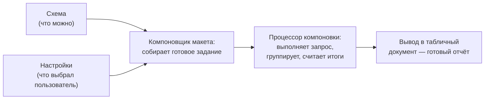

---
tags:
  - 1С/скд
---

> [!abstract] Коротко
> **СКД** строит отчёт по **схеме** (наборы данных, ресурсы, параметры) и **настройкам** (структура, поля, отборы, оформление). Схема → компоновщик макета → процессор компоновки → вывод в табличный документ. Простой отчёт делается без кода.

## Что такое СКД и зачем она нужна

Мы научились получать данные запросом. Но пользователю нужен не просто запрос, а **отчёт**: с заголовком, выбором периода, группировками, итогами, возможностью отобрать покупателя, поменять колонки, вывести диаграмму, сохранить свои настройки. Писать всё это кодом — огромная работа.

**СКД — система компоновки данных** — механизм платформы, который делает это за нас. Мы **описываем** отчёт (откуда брать данные и как их показать), а СКД сама:
- выполняет запрос;
- группирует строки и считает итоги;
- строит форму отчёта с выбором периода и кнопкой «Сформировать»;
- даёт пользователю менять отборы, сортировки и колонки — без программиста;
- выводит результат в таблицу или диаграмму.

Почти все отчёты в типовых конфигурациях 1С построены на СКД. Умение собрать отчёт на СКД — обязательный навык junior-разработчика.

## Две главные части: схема и настройки

Отчёт на СКД описывается двумя частями. Удобная аналогия — **ресторан**:

| Часть | Аналогия | Что содержит |
| --- | --- | --- |
| **Схема компоновки данных** | Кухня и **меню**: какие продукты есть и какие блюда *можно* приготовить | Наборы данных (запросы), ресурсы (формулы итогов), параметры, вычисляемые поля |
| **Настройки** | **Заказ** гостя: что именно подать и как | Какие группировки, какие колонки вывести, отборы, сортировка, оформление |

Схема задаёт **возможности** отчёта, настройки — **конкретный способ** его показать. На одной схеме можно сделать несколько вариантов настроек: «по товарам», «по покупателям», «диаграмма» — без нового запроса.

## Из чего состоит схема

| Часть схемы | Вкладка в редакторе | На какой вопрос отвечает |
| --- | --- | --- |
| Набор данных | **Наборы данных** | Откуда брать строки? Обычно — запрос |
| Ресурсы | **Ресурсы** | Какие показатели и по каким формулам считать в итогах? |
| Параметры | **Параметры** | Какие значения пользователь вводит перед формированием (период)? |
| Вычисляемые поля | **Вычисляемые поля** | Какие колонки считать формулой поверх набора? |
| Настройки | **Настройки** | Что выводить, как группировать, отбирать и оформлять? |

## Что происходит при нажатии «Сформировать»

В простом отчёте эти шаги платформа делает **сама**, без единой строки кода. Мы только заполняем вкладки схемы мышкой. Управлять этими шагами кодом нужно редко — это тема [[28. Программное формирование отчёта СКД]].

> [!warning] Не путаем
> **Система** компоновки данных — механизм платформы (один на все отчёты). **Схема** компоновки данных — описание *нашего конкретного* отчёта. [Устройство СКД в документации 1С](https://v8.1c.ru/platforma/sistema-komponovki-dannykh/).

## Где открыть схему

В Конфигураторе: **Отчёты → нужный отчёт → двойной щелчок → вкладка «Основные» → кнопка «Открыть схему компоновки данных»**.

![[01-Отчёт-и-основная-схема.jpg]]

*В базе уже есть `ОтчетПоПродажам` из раздела 01. Для практики этого раздела создадим отдельный отчёт `ПродажиЗаПериодУчебный`, чтобы не испортить готовый.*

## План следующих уроков

Мы соберём один отчёт «Продажи за период» по шагам — по уроку на каждую вкладку схемы:

| Урок | Что делаем |
| --- | --- |
| [[20. Создание отчёта и набора данных]] | Создаём отчёт и запрос |
| [[21. Поля и ресурсы СКД]] | Настраиваем итоги |
| [[22. Параметры периода в СКД]] | Даём пользователю выбрать период |
| [[23. Структура отчёта и выбранные поля]] | Задаём группировки и колонки |
| [[24. Отбор, сортировка и пользовательские настройки]] | Добавляем отборы и сортировку |
| [[25. Вычисляемые поля и оформление]] | Средняя цена и цветовое выделение |
| [[26. Таблицы, диаграммы и варианты отчёта]] | Таблица и диаграмма на той же схеме |

> [!warning] Запроса недостаточно
> Частая ошибка: создали набор данных с правильным запросом, сформировали отчёт — а он пустой. Причина в том, что **не настроена структура**: СКД не знает, какие группировки и колонки выводить. Отчёт оживает только после настроек ([[23. Структура отчёта и выбранные поля]]).

> [!question]- Проверь себя
> 1. Чем схема отличается от настроек?
> 2. Почему отчёт с готовым запросом может ничего не выводить?
> 3. Нужно ли программировать для простого отчёта по регистру?
>
> > [!success]- Ответы
> > 1. Схема описывает доступные данные и возможности, настройки — конкретный способ их вывести.
> > 2. Не задана структура и выбранные поля в настройках.
> > 3. Нет, достаточно схемы и настроек.

%% навигация %%

---
← [[03. Язык запросов и СКД/18. Проверка и ускорение запросов|18. Проверка и ускорение запросов]] · [[03. Язык запросов и СКД/00. Навигация по разделу|↑ Раздел]] · [[00. Оглавление|⌂ Оглавление]] · [[03. Язык запросов и СКД/20. Создание отчёта и набора данных|20. Создание отчёта и набора данных]] →
