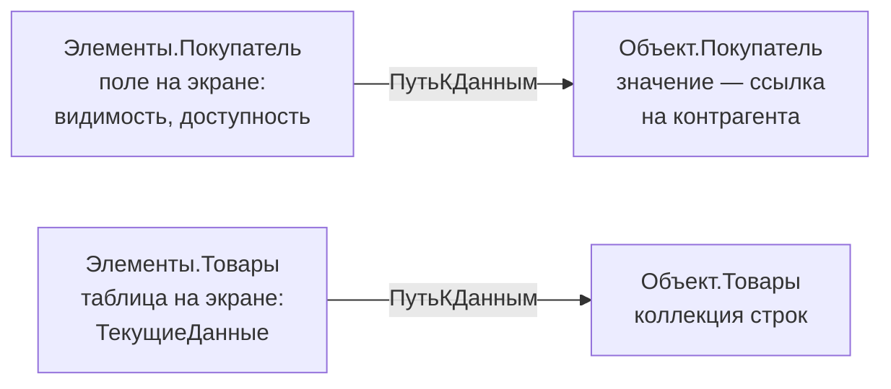

---
tags:
  - 1С/формы
---

> [!abstract] Коротко
> Управляемая форма состоит из четырёх частей: **реквизиты** (данные), **элементы** (что видит пользователь), **команды** (действия) и **модуль** (код). Элемент связан с данными через **ПутьКДанным**. `Объект` — основной реквизит формы документа; это **данные формы**, а не `ДокументОбъект`. Изменения живут в форме до записи.

## Что такое форма

**Форма** — это окно, через которое пользователь работает с данными: вводит покупателя, добавляет строки товаров, нажимает «Провести». Каждый раз, открывая накладную в 1С:Предприятии, вы видите её **форму**.

В разделе 01 платформа строила формы сама — автоматически. Этого хватает для простых справочников. Но как только нужно что-то нестандартное — пересчитать сумму при вводе количества, скрыть поле, добавить кнопку «Подобрать товар», — нужна **собственная форма** и код в ней. Этим и занимается раздел 04.

## Учебный пример раздела

Весь раздел работаем в базе «1С:Купец» с документом `РасходнаяНакладная`:

| Объект | Что используем |
| --- | --- |
| Шапка | `Покупатель` — `СправочникСсылка.Контрагенты` |
| Табличная часть `Товары` | `Товар`, `Количество`, `Цена`, `Сумма` |
| Табличная часть `Услуги` и общий `ИтоговаяСумма` | Существуют, мы их **не трогаем** |
| Реквизит формы `ИтогТоваров` | Создадим в теме 03 — учебный итог только по товарам |

К концу раздела форма накладной будет сама пересчитывать суммы строк и итог, проверять ввод, открывать окно подбора товара и показывать понятные сообщения об ошибках.

> [!warning] Имена из дерева, а не с экрана
> В документе поле называется `Товар`, хотя в регистре продаж — `Номенклатура`. В коде используем имена из дерева конфигурации, а не надписи, которые видит пользователь.

## Четыре части формы

Откройте в Конфигураторе: **Документы → РасходнаяНакладная → Формы → ФормаДокумента** (двойной щелчок). Откроется **редактор формы**:

![[УФ-02-Редактор-формы.png]]

*Редактор формы в «1С:Купец», 8.5.1.1150: слева элементы, справа реквизиты/команды, внизу предпросмотр и вкладка «Модуль».*

Любая управляемая форма состоит из четырёх частей. Удобная аналогия — **кухонный прибор**:

| Часть | Аналогия | За что отвечает | Пример |
| --- | --- | --- | --- |
| **Реквизиты** | Продукты внутри | **Данные**, с которыми работает форма | `Объект`, `ИтогТоваров` |
| **Элементы** | Корпус, дисплей, кнопки | Что **видит** пользователь: поля, таблицы, кнопки, группы | Поле покупателя, таблица товаров |
| **Команды** | Функции прибора | **Действия**, которые можно выполнить | «Показать итог товаров» |
| **Модуль** | Электроника внутри | **Код** — как форма реагирует на действия | Пересчёт суммы, проверка ввода |

Где их найти в редакторе:

| Часть | Где в редакторе |
| --- | --- |
| Элементы | Левая верхняя панель — дерево элементов |
| Реквизиты | Правая верхняя панель, вкладка **Реквизиты** |
| Команды | Правая верхняя панель, вкладка **Команды** |
| Модуль | Нижняя часть, вкладка **Модуль** (рядом с **Форма**) |

Внизу на вкладке **Форма** — предпросмотр: как окно будет выглядеть. Обработчики (код) в предпросмотре **не** работают — только в 1С:Предприятии.

## Данные и элемент — разные вещи

Это самая важная идея раздела, на ней построено всё остальное. **Данные** (реквизит) и **элемент** (поле на экране) — два разных объекта, связанных между собой.

Аналогия: **термометр и температура**. Температура — данные: она существует, даже если термометр убрать. Термометр — элемент: он лишь *показывает* температуру. Можно повесить два термометра, покрасить термометр в синий, спрятать его в шкаф — температура от этого не изменится.



Связь между ними задаёт свойство элемента **ПутьКДанным**: «это поле показывает вот эти данные».

В коде к ним обращаются по-разному:

```1C
// Внутри клиентской процедуры модуля формы
СсылкаНаПокупателя = Объект.Покупатель;          // ДАННЫЕ: кто покупатель
Элементы.Покупатель.ТолькоПросмотр = Истина;     // ЭЛЕМЕНТ: поле на экране нельзя редактировать
```

| Запись | Что это | Что можно делать |
| --- | --- | --- |
| `Объект.Покупатель` | Значение — ссылка на контрагента | Прочитать, присвоить другого покупателя |
| `Элементы.Покупатель` | Поле ввода на экране | Скрыть, сделать недоступным, поменять заголовок |

Вторая строка примера не меняет покупателя — она лишь запрещает редактировать его через это поле.

> [!warning] Удаление поля ≠ удаление данных
> Удалили поле из дерева элементов — реквизит документа остался в базе, пропал лишь способ его показать. Удаление реквизита **в дереве конфигурации** — уже изменение структуры данных.

## Что такое `Объект`

У формы документа есть главный реквизит — **`Объект`**. Это данные самого документа: покупатель, дата, строки товаров. Через `Объект` форма читает и меняет документ.

Важная тонкость: тип `Объект` — не «документ», а **данные формы** (`ДанныеФормыСтруктура`). Это облегчённая копия документа, специально приспособленная для передачи между клиентом и сервером. Поэтому:

- реквизиты читаются и меняются как обычно: `Объект.Покупатель`, `Объект.Товары`;
- но методов объекта документа (`Записать()`, экспортных процедур модуля объекта) у `Объект` **нет** — ни на клиенте, ни в серверных процедурах формы.

Записывает документ стандартная команда формы «Записать» или «Провести». Как вызвать метод модуля объекта из формы — разберём в [[14. Данные формы и прикладной объект]].

Пока документ не записан, все изменения живут только в открытой форме: пользователь может закрыть окно без сохранения — и в базе ничего не изменится.

## Почему форма «управляемая»

В старых версиях 1С разработчик рисовал форму: ставил поле в точку с координатами (100; 50). Управляемая форма устроена иначе: мы описываем **дерево элементов и свойства**, а разместить их на экране платформа решает сама — с учётом размера окна и вида клиента (тонкий клиент, браузер, мобильное устройство). Координат полей нет.

Ещё одна особенность — работа в **клиент-серверной модели**: на клиенте (компьютер пользователя) — ввод и кнопки, на сервере — обращения к базе и запросы. Это действует даже в файловой базе на одном компьютере. Код формы помечается директивами `&НаКлиенте` и `&НаСервере` — подробно в [[05. Модуль формы и клиент-сервер]]. Общий принцип — в [документации 1С об управляемых формах](https://kb.1ci.com/1C_Enterprise_Platform/1C_Enterprise_Platform_Overview/Rapid_development_environment/Forms/?language=en).

## Упражнение: найдите четыре части

1. Откройте `ФормаДокумента` расходной накладной.
2. В дереве элементов выберите поле покупателя. В палитре свойств (`Alt+Enter`) найдите **Имя** и **ПутьКДанным** — убедитесь, что это разные свойства: имя элемента — `Покупатель`, путь — `Объект.Покупатель`.

![[УФ-30-Свойства-поля.png]]

*Поле `Покупатель` и его свойства: «Имя» — `Покупатель` (имя элемента), «ПутьКДанным» — `Объект.Покупатель` (какие данные показывает поле).*

3. На вкладке **Реквизиты** раскройте `Объект` (значок «+») и найдите внутри `Покупатель` и табличную часть `Товары`.
4. Выберите таблицу товаров в дереве элементов — её путь к данным `Объект.Товары`.
5. Найдите вкладки **Команды** и **Модуль**.

Если `Объекта` с реквизитами накладной нет — вы открыли не ту форму (например, форму списка).

> [!question]- Проверь себя
> 1. Где хранится выбранный покупатель — в `Элементы.Покупатель` или `Объект.Покупатель`?
> 2. Можно ли на клиенте вызвать `Объект.Записать()`?
> 3. Удалили поле «Договор» с формы. Пропали ли договоры в документах?
>
> > [!success]- Ответы
> > 1. В `Объект.Покупатель`; элемент лишь показывает его.
> > 2. Нет: `Объект` — данные формы, а не объект документа. Запись делает стандартная команда или серверный код.
> > 3. Нет, удалён только элемент интерфейса.

%% навигация %%

---
← [[04. Программирование управляемых форм/00. Навигация по разделу|00. Навигация по разделу]] · [[00. Оглавление|⌂ Оглавление]] · [[04. Программирование управляемых форм/02. Создание формы документа|02. Создание формы документа]] →
