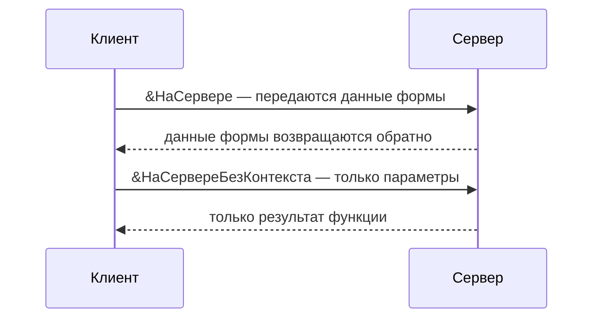

---
tags:
  - 1С/формы
---

> [!abstract] Коротко
> Каждый метод модуля формы помечается директивой: `&НаКлиенте` — интерфейс и действия пользователя, `&НаСервере` — сервер **с данными формы**, `&НаСервереБезКонтекста` — сервер **только с параметрами** (быстрее), `&НаКлиентеНаСервереБезКонтекста` — где вызвали. Работа с базой — только на сервере. Число серверных вызовов минимизируем.

## Клиент и сервер — простыми словами

В управляемом приложении программа работает **на двух компьютерах** (или в двух «половинках» одной программы, если база файловая):

| | Клиент | Сервер |
| --- | --- | --- |
| Где | Компьютер пользователя (или браузер) | Сервер 1С рядом с базой данных |
| Что умеет | Показывать окна, реагировать на клики и ввод, задавать вопросы | Читать и писать базу, выполнять запросы, работать с объектами |
| Чего не умеет | Обращаться к базе напрямую | Показывать окна и спрашивать пользователя |

Аналогия — **ресторан**. Клиент — это **официант** в зале: принимает заказ, общается с гостем, приносит блюда. Сервер — **кухня**: там продукты (база данных) и повара (запросы). Официант не готовит сам — он передаёт заказ на кухню и ждёт. Повар не выходит в зал спрашивать гостя — он работает с тем, что ему передали.

Каждая передача «зал ↔ кухня» — это **серверный вызов**. Он занимает время (особенно если сервер далеко), поэтому хорошая программа гоняет официанта как можно реже.

> [!info] А если база файловая?
> В файловой базе «кухня» работает на том же компьютере, но разделение всё равно соблюдается: код на клиенте не может выполнить запрос. Так программа без изменений заработает и в клиент-серверном варианте, и в браузере.

## Модуль формы и модуль объекта

**Модуль формы** (вкладка «Модуль» в редакторе) — код **этой** формы: реакции на кнопки, ввод, открытие окна. **Модуль объекта** документа — правила записи и проведения, которые работают **и без формы** (например, когда документ записывает обработка).

![[УФ-08-Модуль-формы.png]]

*Модуль существующей формы накладной: директивы `&НаКлиенте`, `&НаСервере` перед каждым методом.*

> [!tip] Где что писать
> Быстрый пересчёт при вводе — в форме. Гарантированный пересчёт и проверки при записи — в модуле объекта. Перед правками читаем существующие методы: вторую процедуру с тем же именем создать нельзя.

## Директивы: где выполнится процедура

Перед **каждой** процедурой и функцией модуля формы пишется **директива** — пометка, где её выполнять:

| Директива | Где выполняется | Что доступно | Аналогия |
| --- | --- | --- | --- |
| `&НаКлиенте` | На клиенте | Данные формы, элементы, окна, вопросы | Официант в зале |
| `&НаСервере` | На сервере, **с данными формы** | Реквизиты формы (`Объект`…), запросы, объекты базы | Официант относит на кухню **весь поднос** с заказом |
| `&НаСервереБезКонтекста` | На сервере, **без данных формы** | Только то, что передали параметрами | Официант передаёт на кухню **одну записку** |
| `&НаКлиентеНаСервереБезКонтекста` | Там, откуда вызвали | Только параметры и вычисления | Рецепт, который знают и в зале, и на кухне |



`&НаСервере` удобен — на сервере доступны все реквизиты формы. Но за удобство платим: при вызове на сервер и обратно передаётся **вся** форма — все строки таблиц, все реквизиты. `&НаСервереБезКонтекста` передаёт только параметры — быстрее.

> [!warning] На сервере нет интерфейса
> Даже с контекстом формы на сервере нет «текущей строки таблицы» и нельзя показать окно или задать вопрос. Всё интерактивное — только на клиенте.

## Пример: два способа получить имя покупателя

Задача: показать сообщением наименование покупателя. Ссылка на покупателя есть на клиенте, а его наименование лежит в базе — значит, нужен сервер.

```1C
// Способ 1: с контекстом формы
&НаСервере
Функция ПредставлениеПокупателяСКонтекстом()
	Если НЕ ЗначениеЗаполнено(Объект.Покупатель) Тогда
		Возврат "Покупатель не выбран";
	КонецЕсли;
	Возврат Объект.Покупатель.Наименование;   // читает Объект — нужны данные формы
КонецФункции

// Способ 2: без контекста — предпочтительный
&НаСервереБезКонтекста
Функция ПредставлениеПокупателя(СсылкаНаПокупателя)
	Если НЕ ЗначениеЗаполнено(СсылкаНаПокупателя) Тогда
		Возврат "Покупатель не выбран";
	КонецЕсли;
	Возврат СсылкаНаПокупателя.Наименование;  // работает только с параметром
КонецФункции
```

Вызов второй функции из клиентского обработчика кнопки той же формы:

```1C
&НаКлиенте
Процедура ПоказатьПокупателя(Команда)
	ИмяПокупателя = ПредставлениеПокупателя(Объект.Покупатель);
	Сообщить(ИмяПокупателя);
КонецПроцедуры
```

Что происходит по шагам:
1. Клиент берёт ссылку `Объект.Покупатель` из данных формы.
2. Вызывает серверную функцию и передаёт ей **только ссылку** — «записку на кухню».
3. Сервер читает наименование из базы и возвращает строку.
4. Клиент показывает сообщение.

Вторая функция предпочтительнее: на сервер уходит одна ссылка, а не вся форма с таблицами. Обращение к `Объект` внутри `&НаСервереБезКонтекста` — **ошибка**: данных формы там нет.

Для вызова метода **своей** формы с сервера ничего дополнительно настраивать не нужно. Флажок «Вызов сервера» относится к общим модулям ([[02. Программирование/26. Общие модули и контекст выполнения|26. Общие модули]]).

## Правила хорошего тона

- **Передаём простые значения**: числа, строки, ссылки, структуры. Не передаём на клиент `ДокументОбъект` — на тонком клиенте его не существует.
- **Сложение двух чисел — на клиенте.** Не нужно ходить на сервер за тем, что можно посчитать на месте.
- **Цены для ста строк — одним вызовом**, а не ста. Собираем товары в массив и получаем все цены за один раз.
- **Данные при открытии формы готовим в `ПриСозданииНаСервере`**, а не вызовом сервера из `ПриОткрытии` ([[07. Создание, открытие и закрытие формы]]) — см. [стандарт 1С об оптимизации серверных вызовов](https://kb.1ci.com/1C_Enterprise_Platform/Guides/Developer_Guides/1C_Enterprise_Development_Standards/Client_server_interaction/Server_call_optimization/?language=en).

Серверный вызов **синхронный**: клиент ждёт ответа, и код продолжится, только когда придёт результат. Это не фоновое выполнение.

## Типичные ошибки

| Сообщение или симптом | Причина | Что сделать |
| --- | --- | --- |
| «Переменная не определена (Объект)» | Метод `&НаСервереБезКонтекста` обращается к данным формы | Передать нужное значение параметром |
| «Тип не определён (Запрос)» / «Метод недоступен на клиенте» | Запрос или `ПолучитьОбъект()` в процедуре `&НаКлиенте` | Вынести в серверную функцию |
| Функция есть, но ничего не происходит | Её никто не вызывает: нет связи с командой или событием | Проверить свойство «Действие» команды или событие элемента |
| Метод не виден из другого модуля | Методы формы локальны | Общие методы — в общих модулях |
| Директиву забыли | Без директивы метод формы считается `&НаСервере` | Всегда писать директиву явно |

> [!question]- Проверь себя
> 1. Почему `&НаСервереБезКонтекста` предпочтительнее `&НаСервере`?
> 2. Можно ли в серверном методе формы спросить пользователя «Продолжить?»
> 3. Где выполнить запрос цены выбранного товара?
>
> > [!success]- Ответы
> > 1. Не передаются данные формы — меньше трафика и быстрее.
> > 2. Нет, вопросы — только на клиенте.
> > 3. В серверной функции (лучше без контекста), передав ссылку на товар.

%% навигация %%

---
← [[04. Программирование управляемых форм/04. Группы и страницы|04. Группы и страницы]] · [[04. Программирование управляемых форм/00. Навигация по разделу|↑ Раздел]] · [[00. Оглавление|⌂ Оглавление]] · [[04. Программирование управляемых форм/06. Команды формы и кнопки|06. Команды формы и кнопки]] →
