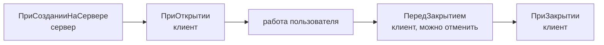

---
tags:
  - 1С/формы
---

> [!abstract] Коротко
> Жизненный цикл формы: `ПриСозданииНаСервере` (сервер — подготовка данных и настроек) → `ПриОткрытии` (клиент) → … → `ПередЗакрытием` (можно отменить) → `ПриЗакрытии`. Начальные значения готовим **на сервере при создании**, чтобы не делать лишний серверный вызов. Обработчик работает, только если он **назначен** в свойствах формы.

## Жизнь формы — от открытия до закрытия

В прошлом уроке итог считался по кнопке. Но удобнее, чтобы при открытии накладной итог **сразу** был посчитан. Для этого нужно выполнить код в момент открытия формы. Платформа сообщает о таких моментах **событиями** формы.

Каждая форма проходит один и тот же путь:



Аналогия — **приход гостя в ресторан**: кухня заранее готовит стол (`ПриСозданииНаСервере`), официант встречает гостя и подаёт меню (`ПриОткрытии`), гость обедает (работа пользователя), перед уходом его спрашивают «Вы точно всё?» (`ПередЗакрытием`) и прощаются (`ПриЗакрытии`).

| Событие | Где | Когда | Для чего |
| --- | --- | --- | --- |
| `ПриСозданииНаСервере` | Сервер, с данными формы | Форма создаётся, окна ещё нет | Начальные значения, настройка элементов, данные из базы |
| `ПриОткрытии` | Клиент | Окно показывается пользователю | Клиентские действия при показе окна |
| `ПередЗакрытием` | Клиент | Пользователь закрывает окно | Проверка, можно ли закрыть (`Отказ = Истина` — не закрывать) |
| `ПриЗакрытии` | Клиент | Окно уже закрывается | Завершающие действия; отменить закрытие уже нельзя |

Если платформа активирует **уже открытое** окно (например, пользователь второй раз открыл ту же накладную), оно не создаётся заново — `ПриСозданииНаСервере` не повторится.

## Где найти события формы

1. В редакторе формы — вкладка **Форма** (внизу).
2. В дереве элементов выделяем **корень** «Форма» — не поле и не таблицу! События корня — это события всей формы.
3. Палитра свойств (`Alt+Enter`) → раздел **События**.

![[УФ-07-События-формы.png]]

*События формы накладной: `ПриСозданииНаСервере`, `ПриОткрытии`, `ПередЗаписью` и другие.*

У каждого события справа кнопка с лупой:
- если обработчик **уже есть** — кнопка открывает его в модуле;
- если **нет** — создаёт заготовку с правильными параметрами.

> [!warning] Связь обязательна
> Процедура с именем `ПриОткрытии`, написанная в модуле вручную, **не вызовется**, если она не указана в свойствах формы. В модуле формы платформа ищет обработчик по ссылке из свойства, а не по имени процедуры. Поэтому обработчики всегда создаём кнопкой у события. См. [учебный разбор 1С](https://kb.1ci.com/1C_Enterprise_Platform/Tutorials/Practical_developer_guide_8.3/Lesson_5._Theory/Event_handler_procedures_in_form_modules/).

## Начальный итог при создании формы

Создаём (или открываем существующий) обработчик `ПриСозданииНаСервере` и добавляем строку расчёта:

```1C
&НаСервере
Процедура ПриСозданииНаСервере(Отказ, СтандартнаяОбработка)

	ИтогТоваров = Объект.Товары.Итог("Сумма");

КонецПроцедуры
```

| Параметр | Смысл |
| --- | --- |
| `Отказ` | Если установить `Истина`, форма не откроется |
| `СтандартнаяОбработка` | Служебный параметр; обычно не трогаем |

Почему на сервере? `ПриСозданииНаСервере` выполняется **до** того, как форма уйдёт на клиент. Посчитав итог здесь, мы отправим клиенту уже готовые данные — **без лишнего** серверного вызова. Это правильный способ готовить начальные значения.

К этому моменту `Объект.Товары` уже заполнен: для существующей накладной — её строками, для новой — пусто (итог 0). Документ при открытии **не записываем**.

Если обработчик уже существует и в нём есть код — добавляем только свою строку, не удаляя чужое. Не пишем `Отказ = Ложь`: его могла установить другая проверка.

## `ПриОткрытии` — для клиентских действий

```1C
&НаКлиенте
Процедура ПриОткрытии(Отказ)
	Сообщить("Форма открыта. Итог товаров: " + ИтогТоваров);   // временная диагностика
КонецПроцедуры
```

Это пример, чтобы увидеть порядок событий: к моменту `ПриОткрытии` итог уже посчитан на сервере. После проверки строку удаляем.

Данные из базы в `ПриОткрытии` **не получаем** — их готовит `ПриСозданииНаСервере`. Вызов сервера из `ПриОткрытии` — лишний «поход на кухню».

## Закрытие формы

Если документ изменён и не записан, платформа **сама** спросит «Данные были изменены. Сохранить изменения?». Не заменяем это своим вопросом без причины. Закрытие окна не означает записи документа.

Если нужно своё подтверждение — используем `ПередЗакрытием` и асинхронный вопрос ([[22. Асинхронные вопросы пользователю]]). При завершении всего приложения в обработчиках закрытия есть ограничения — см. [документацию 1С](https://kb.1ci.com/1C_Enterprise_Platform/Guides/Developer_Guides/1C_Enterprise_8.3.23_Developer_Guide/Chapter_7._Forms/7.9._Working_with_a_form_from_the_1C_Enterprise_language/7.9.7._Different_approaches_to_modality/?language=en).

## Проверка

1. Откройте накладную с суммами 300 и 300 — в поле итога **сразу 600**, без нажатия кнопки. Новая пустая накладная — **0**.
2. Поставьте точки останова (`F9`) в обоих обработчиках и откройте накладную в режиме отладки: сначала остановится `ПриСозданииНаСервере` (сервер), затем `ПриОткрытии` (клиент).

Не вызывайте обработчики друг из друга «для проверки»: прямой вызов не воспроизводит жизненный цикл формы.

> [!question]- Проверь себя
> 1. Почему данные для формы готовят в `ПриСозданииНаСервере`, а не в `ПриОткрытии`?
> 2. В каком событии можно отменить закрытие?
> 3. Переключились на уже открытую накладную. Сработает ли `ПриСозданииНаСервере`?
>
> > [!success]- Ответы
> > 1. Форма создаётся на сервере — данные уходят на клиент вместе с ней, без лишнего вызова.
> > 2. `ПередЗакрытием` (параметр `Отказ`).
> > 3. Нет, форма не создаётся повторно.

%% навигация %%

---
← [[04. Программирование управляемых форм/06. Команды формы и кнопки|06. Команды формы и кнопки]] · [[04. Программирование управляемых форм/00. Навигация по разделу|↑ Раздел]] · [[00. Оглавление|⌂ Оглавление]] · [[04. Программирование управляемых форм/08. Изменение полей и обработчики событий|08. Изменение полей и обработчики событий]] →
