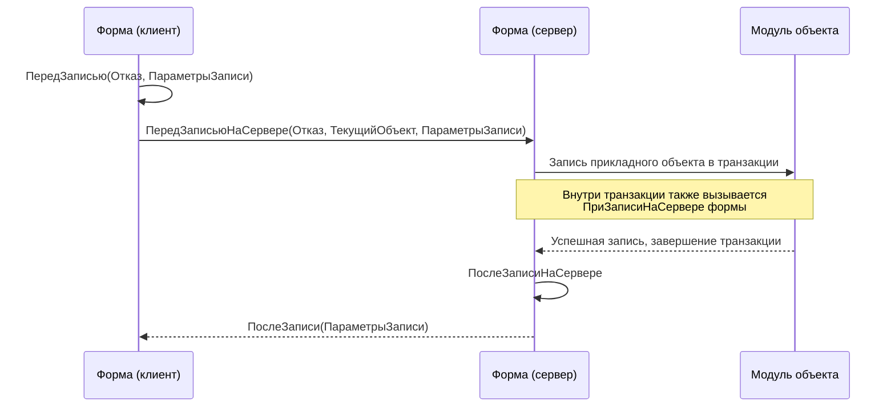
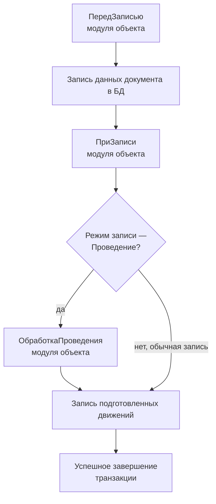

---
tags:
  - 1С/формы
---

> [!abstract] Коротко
> При записи из формы платформа превращает данные формы в прикладной объект. В модуле объекта основные этапы: `ПередЗаписью` → запись данных документа → `ПриЗаписи` → при проведении `ОбработкаПроведения` и запись движений. Эти изменения выполняются в транзакции. Форма добавляет свои события до, во время и после записи; записываемый прикладной объект в её серверных событиях — `ТекущийОбъект`.

## Что происходит при нажатии «Записать»

Для пользователя запись — одна кнопка. Внутри платформа выполняет целую цепочку шагов, и на каждом шаге может вызвать наш код:

1. **Форма на клиенте** спрашивает: «Можно записывать?» — тут удобно сделать быструю проверку.
2. Данные формы (`Объект`) отправляются **на сервер** и превращаются в настоящий **объект документа** — с его модулем объекта.
3. **Модуль объекта** проверяет и дорасчитывает данные (`ПередЗаписью`), документ записывается в базу, при проведении формируются движения.
4. Результат возвращается **в форму**, и та обновляет экран.

Аналогия — **отправка посылки на почте**: вы упаковываете её дома (форма проверяет), отдаёте в окошко (данные уходят на сервер), почта взвешивает и проверяет содержимое по своим правилам (модуль объекта), регистрирует отправление (запись в базу) и выдаёт квитанцию (форма показывает результат). Если на почте нашли запрещённый предмет — посылку не примут, как бы хорошо она ни была упакована.

Все изменения шага 3 выполняются в одной **транзакции**: если на любом этапе запись отменена или возникла ошибка, база возвращается в исходное состояние — «всё или ничего» ([[02. Программирование/28. Транзакции и блокировки|28. Транзакции и блокировки]]).

## Стандартные команды

| Команда | Что делает |
| --- | --- |
| «Записать» | Записывает, форма остаётся открытой |
| «Записать и закрыть» | Записывает и закрывает при успехе |
| «Провести» / «Провести и закрыть» | Запись в режиме проведения — с движениями |

Проведение — отдельная операция; не подменяем её `Объект.Проведен = Истина`.

![[УФ-12-Форма-в-предприятии.png]]

*Форма накладной со стандартными командами записи и проведения.*

## Порядок событий

Сначала рассмотрим основные этапы **формы** при успешной записи. Проверку заполнения и подписки пока опускаем:



Внутри этапа записи **самого документа** соблюдается следующий порядок:



`ПриЗаписи` объекта выполняется **до** `ОбработкаПроведения`, а не после неё. При обычной записи обработчик проведения не вызывается. Схема предполагает стандартную запись движений платформой; код проведения также может явно записывать наборы раньше. Если обработчик откажет в записи или возникнет исключение, транзакция откатит и данные документа, и записанные в ней движения. При отмене проведения вместо `ОбработкаПроведения` вызывается `ОбработкаУдаленияПроведения` — это отдельный сценарий. Порядок записи документа описан в [официальном материале 1С](https://kb.1ci.com/1C_Enterprise_Platform/FAQ/Development/Standards/Applied_objects/).

| Где | Обработчик | Для чего |
| --- | --- | --- |
| Форма, клиент | `ПередЗаписью(Отказ, ПараметрыЗаписи)` | Быстрая проверка, вопрос пользователю |
| Форма, сервер | `ПередЗаписьюНаСервере(Отказ, ТекущийОбъект, ПараметрыЗаписи)` | Перенести в `ТекущийОбъект` данные из реквизитов формы |
| **Модуль объекта** | `ПередЗаписью(Отказ, РежимЗаписи, РежимПроведения)` | **Обязательные** правила и расчёты |
| **Модуль объекта** | `ПриЗаписи(Отказ)` | Действия после записи данных документа, ещё в транзакции и до проведения |
| **Модуль объекта** | `ОбработкаПроведения(Отказ, Режим)` | Движения документа при записи в режиме проведения |
| Форма, сервер | `ПриЗаписиНаСервере(Отказ, ТекущийОбъект, ПараметрыЗаписи)` | Действия формы внутри транзакции записи |
| Форма, сервер | `ПослеЗаписиНаСервере(ТекущийОбъект, ПараметрыЗаписи)` | Действия после успешного завершения транзакции |
| Форма, клиент | `ПослеЗаписи(ПараметрыЗаписи)` | Обновить интерфейс, сообщить об успехе |

Для проверки ставим точки останова в `ПередЗаписью`, `ПриЗаписи` и `ОбработкаПроведения` модуля объекта. При проведении они сработают именно в этом порядке; при обычной записи третьей остановки не будет. Полную последовательность с проверкой заполнения, событиями формы и подписками прослеживаем отладчиком в своей конфигурации.

> [!info] `ТекущийОбъект`
> В серверных событиях записи формы это уже прикладной объект, который будет записан. Чтобы перенести значение из реквизита формы в документ — меняем `ТекущийОбъект.Реквизит`, а не `Объект.Реквизит`.

## Клиентская проверка

Свойства корня формы → События → **ПередЗаписью** (клиент):

```1C
&НаКлиенте
Процедура ПередЗаписью(Отказ, ПараметрыЗаписи)

	Если Отказ Тогда
		Возврат;
	КонецЕсли;
	Если НЕ ПроверитьДанныеФормы() Тогда   // из темы 12
		Отказ = Истина;
	КонецЕсли;

КонецПроцедуры
```

Разберём:

| Код | Смысл |
| --- | --- |
| `ПередЗаписью(Отказ, ПараметрыЗаписи)` | Событие **формы** — вызывается до отправки данных на сервер |
| `Если Отказ Тогда Возврат;` | Если запись уже отменила другая проверка — ничего не делаем |
| `ПроверитьДанныеФормы()` | Функция из урока 12: показывает сообщение у поля и возвращает `Ложь` при ошибке |
| `Отказ = Истина` | Отменить запись: данные даже не уйдут на сервер |

`ПараметрыЗаписи` — параметры операции (режимы записи/проведения), а не реквизиты документа.

Клиентская проверка экономит серверный вызов: пользователь сразу видит ошибку. Но она **не заменяет** серверную — та сработает и при записи без формы.

## Окончательный расчёт в объекте

В модуле объекта `РасходнаяНакладная`:

```1C
Процедура ПересчитатьСуммыТоваров() Экспорт
	Для Каждого СтрокаТовара Из Товары Цикл
		СтрокаТовара.Сумма = Окр(СтрокаТовара.Количество * СтрокаТовара.Цена, 2);
	КонецЦикла;
КонецПроцедуры

Процедура ПередЗаписью(Отказ, РежимЗаписи, РежимПроведения)

	Если Отказ Тогда
		Возврат;
	КонецЕсли;
	Если НЕ ДанныеКорректны() Тогда   // из темы 12
		Отказ = Истина;
		Возврат;
	КонецЕсли;

	ПересчитатьСуммыТоваров();
	// Существующий расчёт услуг и общего итога документа — сохраняем

КонецПроцедуры
```

Что здесь происходит:
1. `ПередЗаписью` модуля объекта вызывается **всегда** — и из формы, и из обработки.
2. Сначала проверка (урок 12); при ошибке — `Отказ` и выход.
3. Потом **окончательный** пересчёт сумм строк. Даже если в форме суммы посчитаны неверно или документ создала обработка, в базу попадут правильные суммы.
4. `Экспорт` у `ПересчитатьСуммыТоваров` нужен, чтобы вызвать её из формы в уроке 14.

> [!warning] Важно
> Дорабатываем существующий `ПередЗаписью`, а не добавляем второй. Если суммы уже считались в цикле — переносим цикл в `ПересчитатьСуммыТоваров()`. `Экспорт` понадобится в теме 14.

## После записи

```1C
&НаКлиенте
Процедура ПослеЗаписи(ПараметрыЗаписи)
	ПересчитатьИтогТоваров();   // данные вернулись с сервера уже пересчитанными
КонецПроцедуры
```

Сообщение «Документ записан» уместно здесь, а не до записи. Серверные действия после записи — в `ПослеЗаписиНаСервере`, без отдельного серверного вызова ([стандарт 1С](https://kb.1ci.com/1C_Enterprise_Platform/Guides/Developer_Guides/1C_Enterprise_Development_Standards/Client_server_interaction/Server_call_optimization/?language=en)).

## Своя команда записи

Обычно хватает стандартных. Для изучения:

```1C
&НаКлиенте
Процедура ЗаписатьУчебно(Команда)
	Записать(Новый Структура("РежимЗаписи", РежимЗаписиДокумента.Запись));
КонецПроцедуры
```

`Новый Структура("РежимЗаписи", РежимЗаписиДокумента.Запись)` — параметры записи: обычная запись без проведения. Для проведения передают `РежимЗаписиДокумента.Проведение`.

`Записать()` — метод **формы**: запускает стандартный механизм со всеми событиями. Не пишем `Объект.Записать()` и не вызываем `ПередЗаписью` вручную.

## Проверка

1. Пустой покупатель — запись запрещает клиентская проверка.
2. Точка останова в `ПередЗаписью` объекта — при корректных данных он выполняется.
3. После записи сумма строки = количество × цена с округлением.
4. Переоткрываем документ — строки сохранились, итог восстановился.
5. Запись из серверной обработки с недопустимым количеством — запрещена объектом (события формы там не участвуют).

> [!question]- Проверь себя
> 1. Где разместить правило, которое должно работать и при загрузке из файла?
> 2. В `ПередЗаписьюНаСервере` нужно записать в документ значение реквизита формы. Куда присваиваем?
> 3. Почему в клиентском коде нельзя `Объект.Записать()`?
>
> > [!success]- Ответы
> > 1. В `ПередЗаписью` модуля объекта.
> > 2. В `ТекущийОбъект.ИмяРеквизита`.
> > 3. `Объект` — данные формы, у них нет метода записи; запись формы — метод `Записать()` самой формы.

%% навигация %%

---
← [[04. Программирование управляемых форм/12. Проверка заполнения и сообщения|12. Проверка заполнения и сообщения]] · [[04. Программирование управляемых форм/00. Навигация по разделу|↑ Раздел]] · [[00. Оглавление|⌂ Оглавление]] · [[04. Программирование управляемых форм/14. Данные формы и прикладной объект|14. Данные формы и прикладной объект]] →
