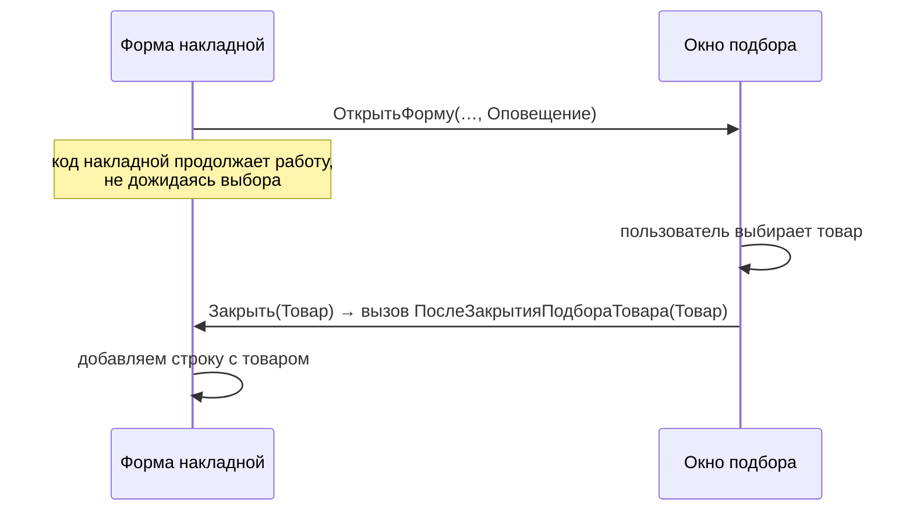

---
tags:
  - 1С/формы
---

> [!abstract] Коротко
> Окно открывается **немодально**: код после `ОткрытьФорму()` не ждёт выбора. Результат получаем в **процедуре-продолжении**, указанной в `Новый ОписаниеОповещения("ИмяПроцедуры", ЭтотОбъект)` и переданной седьмым параметром `ОткрытьФорму`. Процедура — `Экспорт`, параметры `(Результат, ДополнительныеПараметры)`, отмену (`Неопределено`) обрабатываем первой.

## Главная особенность: окно не ждёт

Логично было бы написать так:

```1C
// НЕ РАБОТАЕТ так, как ожидается
Товар = ОткрытьФорму("ОбщаяФорма.ПодборТовараУчебный");
// ... и сразу использовать Товар
```

Но `ОткрытьФорму` **не ждёт**, пока пользователь выберет товар. Окно открывается, а код **сразу** идёт дальше — пользователь ещё ничего не выбрал. Так устроено управляемое приложение: окна **немодальные**, программа не «замирает» в ожидании.

Как тогда получить результат? Мы заранее говорим платформе: «**когда окно закроется**, вызови вот эту мою процедуру и передай ей результат». Это и есть **оповещение о закрытии**.

Аналогия — **заказ в химчистке**. Вы сдали пальто и оставили номер телефона: «Позвоните, когда будет готово». Вы не стоите у стойки — идёте по своим делам. Когда пальто готово, вам звонят. Номер телефона — это `ОписаниеОповещения`, звонок — вызов нашей процедуры с результатом.



## Команда «Подобрать товар»

В форме накладной: команда `ПодобратьТоварУчебно`, кнопка в командной панели таблицы `Товары`.

```1C
&НаКлиенте
Процедура ПодобратьТоварУчебно(Команда)

	ПараметрыФормы = Новый Структура;
	ТекущаяСтрока = Элементы.Товары.ТекущиеДанные;
	Если ТекущаяСтрока <> Неопределено Тогда
		ПараметрыФормы.Вставить("НачальныйТовар", ТекущаяСтрока.Товар);
	КонецЕсли;

	Оповещение = Новый ОписаниеОповещения("ПослеЗакрытияПодбораТовара", ЭтотОбъект);

	ОткрытьФорму("ОбщаяФорма.ПодборТовараУчебный",
		ПараметрыФормы, ЭтотОбъект, , , , Оповещение,
		РежимОткрытияОкнаФормы.БлокироватьОкноВладельца);

КонецПроцедуры

&НаКлиенте
Процедура ПослеЗакрытияПодбораТовара(Результат, ДополнительныеПараметры) Экспорт

	Если Результат = Неопределено Тогда   // отмена или закрытие крестиком
		Возврат;
	КонецЕсли;
	Если ТипЗнч(Результат) <> Тип("СправочникСсылка.Номенклатура")
		Или НЕ ЗначениеЗаполнено(Результат) Тогда
		Возврат;
	КонецЕсли;

	НоваяСтрока = Объект.Товары.Добавить();
	НоваяСтрока.Товар = Результат;
	НоваяСтрока.Количество = 1;

	Элементы.Товары.ТекущаяСтрока = НоваяСтрока.ПолучитьИдентификатор();
	ПересчитатьИтогТоваров();
	Модифицированность = Истина;

КонецПроцедуры
```

Разберём по частям:

| Код | Смысл |
| --- | --- |
| `ПараметрыФормы.Вставить("НачальныйТовар", …)` | Если стоим на строке, передаём её товар в окно — он подставится в поле |
| `Новый ОписаниеОповещения("ПослеЗакрытияПодбораТовара", ЭтотОбъект)` | «Номер телефона»: какую процедуру вызвать (`"ПослеЗакрытия…"`) и в каком модуле её искать (`ЭтотОбъект` — модуль этой формы) |
| `ОткрытьФорму(…, Оповещение, …)` | Открываем окно и оставляем «номер телефона» |
| `Процедура ПослеЗакрытияПодбораТовара(Результат, ДополнительныеПараметры) Экспорт` | Процедура-продолжение. `Результат` — то, что передали в `Закрыть(…)`. `Экспорт` обязателен — иначе платформа не сможет её вызвать |
| `Если Результат = Неопределено Тогда Возврат` | Нажали «Отмену» или крестик — ничего не делаем |

Подтверждение **всегда добавляет новую строку**, текущий товар лишь подставляется в окно. Цена остаётся 0 — получение цены отдельная задача.

## Параметры `ОткрытьФорму`

| № | Параметр | Здесь |
| --- | --- | --- |
| 1 | Имя формы | `"ОбщаяФорма.ПодборТовараУчебный"` |
| 2 | Параметры | Структура с `НачальныйТовар` |
| 3 | Владелец | `ЭтотОбъект` — форма накладной |
| 4–6 | Уникальность, окно, навигационная ссылка | Пропущены |
| 7 | Оповещение о закрытии | `Оповещение` |
| 8 | Режим открытия окна | `БлокироватьОкноВладельца` |

`ОписаниеОповещения` хранит имя процедуры и модуль, где её искать, — поэтому процедура `Экспорт` в модуле этой формы. `БлокироватьОкноВладельца` не даёт редактировать накладную, пока открыт подбор, но **не делает вызов синхронным**. См. [руководство 1С о немодальности](https://kb.1ci.com/1C_Enterprise_Platform/Guides/Developer_Guides/1C_Enterprise_8.3.23_Developer_Guide/Chapter_7._Forms/7.9._Working_with_a_form_from_the_1C_Enterprise_language/7.9.7._Different_approaches_to_modality/?language=en).

> [!tip] Тот же приём — везде
> `ОписаниеОповещения` + процедура-продолжение — общий способ получить результат «позже»: так же работают `ПоказатьВопрос`, `ПоказатьВводЗначения`, выбор файла. Для вопросов и предупреждений есть и форма с `Асинх`/`Ждать` ([[22. Асинхронные вопросы пользователю]]).

## Альтернатива: `ОповеститьОВыборе`

Для подбора из списка, особенно многократного, дочерняя форма вызывает `ОповеститьОВыборе(Значение)`, а владелец получает его в событии **ОбработкаВыбора**:

![[УФ-16-Стандартная-форма-выбора.png]]

*Стандартная форма выбора контрагента — пример выбора из списка.*

| Владелец | Событие и параметры |
| --- | --- |
| Форма | `ОбработкаВыбора(ВыбранноеЗначение, ИсточникВыбора)` |
| Таблица/поле (`Элементы.Товары`) | `ОбработкаВыбора(Элемент, ВыбранноеЗначение, СтандартнаяОбработка)` |

При одиночном выборе `ОповеститьОВыборе` сам закрывает форму, при множественном — окно может остаться открытым. См. [пособие 1С](https://1c-dn.com/library/tutorials/practical_developer_guide_using_notifychoice_method/). В нашем основном примере используем результат закрытия.

## Проверка

1. «Подобрать» → «Отмена» → строк по-прежнему 0.
2. Выбор и подтверждение → одна новая строка, количество 1.
3. На заполненной строке — товар подставлен в окно, подтверждение добавляет ещё строку.
4. Закрытие крестиком → строка не добавляется. Услуги не затронуты, документ не записан.

Продолжение не вызывается — проверяем имя в `ОписаниеОповещения`, `Экспорт` и два параметра процедуры.

> [!question]- Проверь себя
> 1. Почему нельзя добавить строку сразу после строки `ОткрытьФорму(...)`?
> 2. Зачем процедуре-продолжению `Экспорт`?
> 3. Что придёт в `Результат`, если пользователь закрыл окно крестиком?
>
> > [!success]- Ответы
> > 1. `ОткрытьФорму` не ждёт пользователя — выбора ещё нет.
> > 2. Платформа вызывает её «снаружи» через `ОписаниеОповещения`.
> > 3. `Неопределено`.

%% навигация %%

---
← [[04. Программирование управляемых форм/16. Общая форма для подбора товара|16. Общая форма для подбора товара]] · [[04. Программирование управляемых форм/00. Навигация по разделу|↑ Раздел]] · [[00. Оглавление|⌂ Оглавление]] · [[04. Программирование управляемых форм/18. Ограничение выбора значений|18. Ограничение выбора значений]] →
