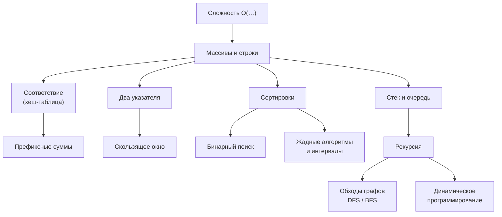

---
tags:
  - 1С/алгоритмы
  - 1С/навигация
---

# 06. Алгоритмы для 1С

> [!abstract] Маршрут раздела
> Алгоритмы и структуры данных на встроенном языке 1С — от понятия сложности до задач уровня технического собеседования на стажировку и junior-позицию: массивы и строки, хеш-таблицы, два указателя, скользящее окно, префиксные суммы, сортировки, бинарный поиск, стек и очередь, рекурсия, обходы графов, динамическое программирование и жадные алгоритмы.

## Перед началом

Нужен уверенный встроенный язык: переменные, условия, циклы, процедуры и функции, массивы и соответствия — темы [[02. Программирование/00. Навигация по разделу|раздела 02]]. Конфигурация и база данных для этого раздела почти не нужны: все задачи решаем в «песочнице» — внешней обработке с кнопкой «Выполнить», которую создаём в первом уроке.

Раздел можно проходить параллельно с разделами 03–05: он не зависит от запросов и форм.

## Как заниматься

1. Прочитайте идею и разбор примера.
2. **Наберите код руками** в песочнице и запустите проверки — не копируйте.
3. Решите задачу «для закрепления» в конце урока **до** того, как откроете решение.
4. Через несколько дней вернитесь и решите задачи урока заново без подсказок.

Ориентировочный темп при 1–2 часах в день — **3–4 недели**. Лучше 1–2 задачи каждый день, чем десять за один вечер раз в неделю.

## Порядок изучения

### Основы

- [[06. Алгоритмы для 1С/01. Что такое алгоритм и как решать задачи|01. Что такое алгоритм и как решать задачи]] ⭐
- [[06. Алгоритмы для 1С/02. Сложность алгоритмов|02. Сложность алгоритмов]] ⭐
- [[06. Алгоритмы для 1С/03. Массивы — базовые приёмы|03. Массивы — базовые приёмы]]
- [[06. Алгоритмы для 1С/04. Строки и символы|04. Строки и символы]]

### Ключевые приёмы

- [[06. Алгоритмы для 1С/05. Соответствие как хеш-таблица|05. Соответствие как хеш-таблица]] ⭐
- [[06. Алгоритмы для 1С/06. Два указателя|06. Два указателя]]
- [[06. Алгоритмы для 1С/07. Скользящее окно|07. Скользящее окно]]
- [[06. Алгоритмы для 1С/08. Префиксные суммы|08. Префиксные суммы]]

### Сортировка и поиск

- [[06. Алгоритмы для 1С/09. Сортировки|09. Сортировки]]
- [[06. Алгоритмы для 1С/10. Бинарный поиск|10. Бинарный поиск]] ⭐

### Структуры данных и рекурсия

- [[06. Алгоритмы для 1С/11. Стек и очередь|11. Стек и очередь]]
- [[06. Алгоритмы для 1С/12. Рекурсия|12. Рекурсия]]
- [[06. Алгоритмы для 1С/13. Обход в глубину и ширину|13. Обход в глубину и ширину]]

### Оптимизация

- [[06. Алгоритмы для 1С/14. Динамическое программирование|14. Динамическое программирование]] ⭐
- [[06. Алгоритмы для 1С/15. Жадные алгоритмы и интервалы|15. Жадные алгоритмы и интервалы]]

### Практика и повторение

- [[06. Алгоритмы для 1С/16. Практика — задачи с собеседований|16. Практика — задачи с собеседований]] 🛠
- [[06. Алгоритмы для 1С/17. Памятка — шаблоны и ошибки|17. Памятка — шаблоны и ошибки]] 📌

## Карта приёмов

## Результат раздела

Умеете оценить сложность решения, выбрать подходящий приём по условию задачи, написать решение на встроенном языке без ошибок на границах и объяснить его вслух. Готовы к алгоритмической части технического собеседования на стажировку или junior-позицию.

## Для повторения

- [[06. Алгоритмы для 1С/17. Памятка — шаблоны и ошибки|Памятка: шаблоны и ошибки]]
- [[07. Шпаргалки/03. Встроенный язык — шпаргалка|Встроенный язык — шпаргалка]]

%% навигация %%

---
[[00. Оглавление|⌂ Оглавление]] · [[06. Алгоритмы для 1С/01. Что такое алгоритм и как решать задачи|Начать раздел]] →
