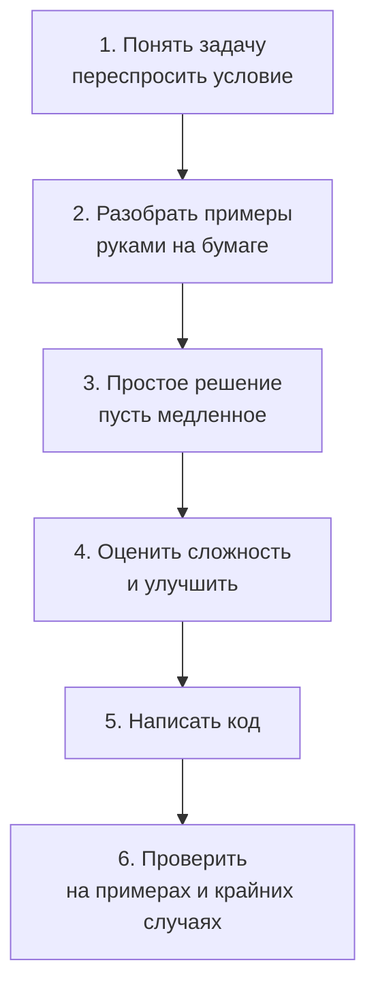

---
tags:
  - 1С/алгоритмы
---

> [!abstract] Коротко
> **Алгоритм** — точная последовательность шагов, которая из входных данных получает результат. На собеседовании важна не только правильность, но и **ход рассуждений**: понять задачу → разобрать примеры → придумать простое решение → улучшить его → проверить крайние случаи. Все задачи раздела решаем на встроенном языке 1С в учебной «песочнице» — внешней обработке с кнопкой «Выполнить» и процедурой `Проверить()`.

## Зачем 1С-разработчику алгоритмы

В повседневной работе 1С-разработчик чаще пишет запросы и формы, чем сортировки. Но алгоритмы нужны по трём причинам:

1. **Собеседования.** Многие компании, особенно крупные банки и IT-компании, на стажировку и junior-позиции дают задачи «на алгоритмы» — и 1С-разработчикам тоже.
2. **Производительность.** Обработка, которая ищет совпадения двумя вложенными циклами, на 100 строках работает мгновенно, а на 100 000 — часами. Понимание сложности алгоритма помогает этого не допустить.
3. **Мышление.** Умение разложить задачу на шаги и предусмотреть крайние случаи делает любой код надёжнее.

## Что такое алгоритм

**Алгоритм** — это точная инструкция: какие шаги в каком порядке выполнить, чтобы из **входных данных** получить **результат**.

Пример из жизни — рецепт омлета:

```text
Вход: 2 яйца, молоко, соль
1. Разбить яйца в миску.
2. Добавить 50 мл молока и щепотку соли.
3. Взбить вилкой.
4. Вылить на разогретую сковороду.
5. Жарить 3 минуты под крышкой.
Результат: омлет
```

Пример из программирования — найти **наибольшее** число в списке `[3, 8, 1, 9, 4]`:

```text
1. Запомнить первое число как «максимум»: максимум = 3.
2. Посмотреть на следующее число. Если оно больше максимума — запомнить его.
   8 > 3 → максимум = 8
   1 > 8? нет
   9 > 8 → максимум = 9
   4 > 9? нет
3. Когда числа закончились — ответ в «максимуме»: 9.
```

Хороший алгоритм:
- **правильный** — даёт верный ответ на **любых** допустимых входных данных, включая крайние случаи (пустой список, одно число, все числа одинаковые);
- **понятный** — его можно объяснить словами;
- **эффективный** — не делает лишней работы (об этом — следующий урок).

## Как решать задачу на собеседовании

На собеседовании проверяют не столько знание готовых решений, сколько умение **рассуждать**. Интервьюер хочет слышать ход мыслей. Используйте один и тот же план для любой задачи:



**1. Понять задачу.** Перескажите условие своими словами и задайте уточняющие вопросы:
- Что на входе? Могут ли числа быть отрицательными? Может ли массив быть пустым?
- Что вернуть, если ответа нет?
- Насколько большие данные: 10 элементов или миллион?

**2. Разобрать примеры.** Возьмите маленький пример и решите его **руками**. Часто именно здесь видно, как устроено решение.

**3. Простое решение.** Сначала придумайте **любое** правильное решение, даже медленное («перебрать все пары»). Скажите о нём вслух — это уже ответ.

**4. Улучшить.** Оцените, сколько операций делает простое решение, и подумайте, как убрать лишнюю работу. В уроках раздела мы разберём типовые приёмы: хеш-таблица, два указателя, окно, сортировка, бинарный поиск.

**5. Написать код.** Аккуратно, с понятными именами переменных.

**6. Проверить.** «Прогоните» код руками по примеру и по **крайним случаям**:

| Крайний случай | Пример |
| --- | --- |
| Пустые данные | Пустой массив, пустая строка |
| Один элемент | `[5]` |
| Все элементы одинаковые | `[2, 2, 2]` |
| Отрицательные числа и ноль | `[-3, 0, -1]` |
| Ответа нет | Искомого числа нет в массиве |
| Граничные позиции | Ответ — первый или последний элемент |

## Песочница для задач

Все примеры раздела удобно запускать в отдельной **внешней обработке** — она не меняет учебную конфигурацию ([[01. Основы конфигурирования/23. Обработки и внешние файлы|23. Обработки и внешние файлы]]).

1. В Конфигураторе: **Файл → Новый → Внешняя обработка**, имя `ПесочницаАлгоритмов`.
2. **Формы → Добавить** → форма обработки, флажок «Назначить форму основной» → **Готово**.
3. В редакторе формы на вкладке **Команды** создаём команду `Выполнить`, в её свойстве «Действие» создаём обработчик **на клиенте** ([[04. Программирование управляемых форм/06. Команды формы и кнопки|06. Команды формы и кнопки]]). Перетаскиваем команду в дерево элементов — появится кнопка.
4. Во вкладке **Модуль** вставляем код ниже.
5. Сохраняем обработку в файл `ПесочницаАлгоритмов.epf` (`Ctrl+S`).
6. Запускаем 1С:Предприятие, **Файл → Открыть** → выбираем файл → нажимаем «Выполнить». Результаты появятся в окне сообщений.

Каркас модуля формы:

```1C
&НаКлиенте
Процедура Выполнить(Команда)
	ЗапуститьПроверки();
КонецПроцедуры

// Сюда добавляем вызовы проверок для текущей задачи.
&НаКлиенте
Процедура ЗапуститьПроверки()
	Проверить("Максимум", Максимум(ЧислаИзСтроки("3,8,1,9,4")), 9);
	Проверить("Максимум из одного", Максимум(ЧислаИзСтроки("5")), 5);
КонецПроцедуры

// Решение задачи.
&НаКлиенте
Функция Максимум(Числа)
	Результат = Числа[0];
	Для Каждого Элемент Из Числа Цикл
		Если Элемент > Результат Тогда
			Результат = Элемент;
		КонецЕсли;
	КонецЦикла;
	Возврат Результат;
КонецФункции

#Область Служебные

// Сравнивает результат с ожидаемым и выводит ОК или ОШИБКА.
&НаКлиенте
Процедура Проверить(Название, Получено, Ожидается)
	Если Получено = Ожидается Тогда
		Сообщить("ОК: " + Название);
	Иначе
		Сообщить("ОШИБКА: " + Название + ". Получено: " + XMLСтрока(Получено)
			+ ", ожидалось: " + XMLСтрока(Ожидается));
	КонецЕсли;
КонецПроцедуры

// "3,8,1" → массив чисел [3, 8, 1]. Пустая строка → пустой массив.
&НаКлиенте
Функция ЧислаИзСтроки(Текст)
	Результат = Новый Массив;
	Если ПустаяСтрока(Текст) Тогда
		Возврат Результат;
	КонецЕсли;
	Для Каждого Часть Из СтрРазделить(Текст, ",") Цикл
		Результат.Добавить(Число(СокрЛП(Часть)));
	КонецЦикла;
	Возврат Результат;
КонецФункции

// Массив [3, 8, 1] → строка "3,8,1" — удобно сравнивать результат-массив.
&НаКлиенте
Функция МассивВСтроку(Значения)
	Части = Новый Массив;
	Для Каждого Элемент Из Значения Цикл
		Части.Добавить(XMLСтрока(Элемент));
	КонецЦикла;
	Возврат СтрСоединить(Части, ",");
КонецФункции

#КонецОбласти
```

Нажимаем «Выполнить» — в окне сообщений:

```text
ОК: Максимум
ОК: Максимум из одного
```

Разберём служебные процедуры:

| Процедура | Зачем |
| --- | --- |
| `Проверить(Название, Получено, Ожидается)` | Мини-тест: сравнивает ответ функции с правильным. Так решение проверяется сразу на нескольких примерах |
| `ЧислаИзСтроки("3,8,1")` | В 1С нет записи массива «в одну строку» вроде `[3, 8, 1]`. Эта функция строит массив из строки — примеры становятся короткими |
| `МассивВСтроку(Массив)` | Два разных массива с одинаковыми элементами при сравнении через `=` **не равны** ([[02. Программирование/08. Операции сравнения|08. Операции сравнения]]). Поэтому массив-результат превращаем в строку и сравниваем строки |

> [!info] Почему `XMLСтрока`, а не `Строка`
> `Строка(1000)` вернёт «1 000» с пробелом-разделителем разрядов, а `Формат(0, "ЧГ=0")` — пустую строку. `XMLСтрока(1000)` всегда даёт «1000», `XMLСтрока(0)` — «0», `XMLСтрока(-2.5)` — «-2.5». Для вывода и сравнения чисел в задачах это удобнее.

Все функции алгоритмов в разделе — **клиентские** (`&НаКлиенте`): им не нужна база данных, только переменные и коллекции. Массив, Соответствие, СписокЗначений и строки доступны на клиенте. А вот `ТаблицаЗначений` на клиенте недоступна — в алгоритмических задачах обходимся без неё.

> [!tip] Как работать с уроками
> Каждую задачу сначала попробуйте решить **сами** в песочнице, и только потом читайте разбор. Прочитанное решение забывается за день, решённое самостоятельно — остаётся.

## Пример полного рассуждения

**Задача.** Дан массив чисел. Вернуть сумму **чётных** чисел.

**1. Понимаем.** Чётное — делится на 2 без остатка. Могут ли быть отрицательные? Допустим, да: −4 тоже чётное. Пустой массив → сумма 0.

**2. Пример руками.** `[1, 2, 3, 4, -6]` → чётные 2, 4, −6 → сумма 0.

**3. Решение.** Пройти по всем числам, складывать те, у которых остаток от деления на 2 равен 0.

**4. Сложность.** Каждое число смотрим один раз — быстрее не бывает (подробнее — в следующем уроке).

**5. Код:**

```1C
&НаКлиенте
Функция СуммаЧетных(Числа)
	Сумма = 0;
	Для Каждого Элемент Из Числа Цикл
		Если Элемент % 2 = 0 Тогда
			Сумма = Сумма + Элемент;
		КонецЕсли;
	КонецЦикла;
	Возврат Сумма;
КонецФункции
```

**6. Проверки:**

```1C
Проверить("Обычный случай", СуммаЧетных(ЧислаИзСтроки("1,2,3,4,-6")), 0);
Проверить("Только нечётные", СуммаЧетных(ЧислаИзСтроки("1,3,5")), 0);
Проверить("Пустой массив", СуммаЧетных(ЧислаИзСтроки("")), 0);
Проверить("Одно чётное", СуммаЧетных(ЧислаИзСтроки("8")), 8);
```

> [!warning] Остаток от отрицательного числа
> В 1С `-6 % 2` равно `0`, а `-5 % 2` равно `-1` (знак остатка совпадает со знаком делимого). Поэтому чётность проверяем условием `Элемент % 2 = 0`, а **не** «нечётное, если остаток равен 1» — для −5 это условие не сработает.

> [!question]- Проверь себя
> 1. Перечислите шесть шагов решения задачи на собеседовании.
> 2. Назовите четыре крайних случая, которые стоит проверить почти в любой задаче на массив.
> 3. Почему массив-результат сравниваем через `МассивВСтроку`, а не напрямую?
> 4. Почему в функции `Максимум` из песочницы для пустого массива будет ошибка и как её избежать?
>
> > [!success]- Ответы
> > 1. Понять задачу → разобрать примеры → простое решение → оценить и улучшить → код → проверка на примерах и крайних случаях.
> > 2. Пустой массив, один элемент, все элементы одинаковые, отрицательные числа/ноль (также: ответа нет, ответ на краю).
> > 3. Оператор `=` сравнивает массивы по экземпляру: два разных массива с одинаковыми элементами не равны.
> > 4. `Числа[0]` у пустого массива — обращение к несуществующему элементу. В начале функции проверяем `Если Числа.Количество() = 0 Тогда Возврат Неопределено; КонецЕсли;` (или договариваемся с интервьюером, что массив не пустой).

%% навигация %%

---
← [[06. Алгоритмы для 1С/00. Навигация по разделу|00. Навигация по разделу]] · [[00. Оглавление|⌂ Оглавление]] · [[06. Алгоритмы для 1С/02. Сложность алгоритмов|02. Сложность алгоритмов]] →
