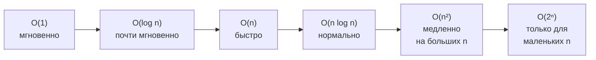

---
tags:
  - 1С/алгоритмы
---

> [!abstract] Коротко
> **Сложность** показывает, как растёт время работы (или расход памяти) при росте объёма данных `n`. Записывается через «O большое»: `O(1)` — не зависит от `n`, `O(log n)` — бинарный поиск, `O(n)` — один проход, `O(n log n)` — хорошая сортировка, `O(n²)` — вложенные циклы. Константы и младшие слагаемые отбрасываем: `3n + 5` → `O(n)`. На собеседовании после каждого решения называйте его сложность по времени и памяти.

## Зачем считать сложность

Две программы могут давать одинаковый ответ, но одна работает секунду, а другая — час. Разница становится заметна, когда данных много.

Представим задачу: в списке из `n` товаров найти, есть ли товары с одинаковым кодом.

| Решение | Сколько сравнений при n = 1 000 | При n = 100 000 |
| --- | --- | --- |
| Сравнить каждый с каждым | ~500 000 | ~5 000 000 000 |
| Запоминать уже виденные коды в соответствии | ~1 000 | ~100 000 |

Первое решение на 100 000 товаров будет работать в десятки тысяч раз дольше второго. Именно поэтому на собеседовании после любого решения спрашивают: «Какая у него сложность? Можно быстрее?».

## Что такое «O большое»

Мы не считаем точное время в секундах — оно зависит от компьютера. Мы оцениваем, **как растёт число операций при росте данных**. Обозначение `O(…)` читается «о от …» и описывает этот рост для **больших** `n`.

Правила упрощения:
1. **Константы отбрасываем:** `2n` и `100n` — это всё `O(n)`. Нас интересует характер роста, а не точное число.
2. **Младшие слагаемые отбрасываем:** `n² + n + 10` → `O(n²)`. При большом `n` слагаемое `n²` настолько больше остальных, что они не важны.
3. **Оцениваем худший случай**, если не сказано иное.

## Основные классы сложности

| Обозначение | Название | Пример | n = 10 | n = 1 000 | n = 1 000 000 |
| --- | --- | --- | --- | --- | --- |
| `O(1)` | Константная | Взять элемент массива по индексу | 1 | 1 | 1 |
| `O(log n)` | Логарифмическая | Бинарный поиск | ~3 | ~10 | ~20 |
| `O(n)` | Линейная | Один проход по массиву | 10 | 1 000 | 1 000 000 |
| `O(n log n)` | Линейно-логарифмическая | Сортировка слиянием | ~30 | ~10 000 | ~20 000 000 |
| `O(n²)` | Квадратичная | Два вложенных цикла | 100 | 1 000 000 | 1 000 000 000 000 |
| `O(2ⁿ)` | Экспоненциальная | Перебор всех подмножеств | 1 024 | — | — |



Практический ориентир: компьютер выполняет порядка десятков миллионов простых операций в секунду (встроенный язык 1С медленнее компилируемых языков, но порядок тот же). Значит, при `n = 100 000` решение `O(n)` или `O(n log n)` уложится в доли секунды, а `O(n²)` — нет.

## Как определить сложность по коду

### `O(1)` — фиксированное число действий

```1C
Первый = Числа[0];
Последний = Числа[Числа.ВГраница()];
```

Неважно, сколько элементов в массиве, — два обращения по индексу.

### `O(n)` — один проход

```1C
Сумма = 0;
Для Каждого Элемент Из Числа Цикл   // n повторений
	Сумма = Сумма + Элемент;         // O(1) на каждом
КонецЦикла;
```

Цикл выполняется `n` раз, тело — за постоянное время: итого `O(n)`.

Два цикла **подряд** — по-прежнему `O(n)`: `n + n = 2n` → `O(n)`.

### `O(n²)` — цикл в цикле

```1C
// Есть ли два одинаковых элемента?
Для i = 0 По Числа.ВГраница() Цикл                 // n раз
	Для j = i + 1 По Числа.ВГраница() Цикл         // до n раз
		Если Числа[i] = Числа[j] Тогда
			Возврат Истина;
		КонецЕсли;
	КонецЦикла;
КонецЦикла;
Возврат Ложь;
```

Для каждого из `n` элементов внутренний цикл проходит до `n` элементов: всего около `n × n / 2` сравнений → `O(n²)`.

> [!tip] Правило большого пальца
> Вложенные циклы по одним и тем же данным — почти всегда `O(n²)`. Увидели такое в своём решении — подумайте, нельзя ли заменить внутренний цикл на поиск в соответствии ([[05. Соответствие как хеш-таблица]]).

### `O(log n)` — каждый шаг уменьшает задачу вдвое

```1C
Шагов = 0;
Пока n > 1 Цикл
	n = Цел(n / 2);   // делим пополам
	Шагов = Шагов + 1;
КонецЦикла;
```

Сколько раз число 1 000 000 можно поделить пополам, пока не останется 1? Около 20 раз. Это и есть логарифм: `log₂(1 000 000) ≈ 20`. Так работает бинарный поиск ([[10. Бинарный поиск]]).

### Скрытая сложность встроенных методов

Не каждая строчка кода — `O(1)`. Некоторые методы коллекций внутри делают проход по всем элементам:

| Операция | Сложность | Почему |
| --- | --- | --- |
| `Массив[i]`, `Массив.Добавить(x)` | `O(1)` | Прямое обращение / добавление в конец |
| `Массив.Найти(x)` | `O(n)` | Перебирает элементы по порядку |
| `Массив.Удалить(0)`, `Массив.Вставить(0, x)` | `O(n)` | Сдвигает все остальные элементы |
| `Соответствие.Получить(ключ)`, `Вставить` | `O(1)` в среднем | Хеш-таблица — см. урок 05 |
| Сортировка `СписокЗначений.СортироватьПоЗначению()` | `O(n log n)` | Хороший алгоритм сортировки |

Поэтому `Массив.Найти()` внутри цикла — это скрытое `O(n²)`:

```1C
Для Каждого Элемент Из Числа Цикл          // n раз
	Если Другие.Найти(Элемент) <> Неопределено Тогда   // O(n) внутри!
		...
```

## Сложность по памяти

Кроме времени оценивают **дополнительную память** — сколько её нужно сверх входных данных.

| Решение | Память |
| --- | --- |
| Сумма элементов (одна переменная) | `O(1)` |
| Копия массива или соответствие со всеми элементами | `O(n)` |
| Таблица `n × n` | `O(n²)` |

Часто есть **компромисс**: тратим `O(n)` памяти на соответствие, чтобы ускорить решение с `O(n²)` до `O(n)`. На собеседовании это нормальный ответ — главное, назвать обе сложности.

## Как отвечать на собеседовании

После решения скажите одной фразой: «Решение работает за **O(n)** по времени, потому что один раз проходим массив, и использует **O(n)** дополнительной памяти на соответствие». Если решение `O(n²)` — скажите это честно и предложите, как ускорить.

> [!question]- Проверь себя
> 1. Упростите: `5n + 3`, `n² + 100n`, `n/2`, `1000`.
> 2. Какая сложность у двух вложенных циклов по одному массиву? А у двух циклов подряд?
> 3. Почему `Массив.Найти()` внутри цикла по массиву даёт `O(n²)`?
> 4. Во сколько раз примерно больше операций сделает решение `O(n²)` по сравнению с `O(n)` при `n = 10 000`?
>
> > [!success]- Ответы
> > 1. `O(n)`, `O(n²)`, `O(n)`, `O(1)`.
> > 2. Вложенные — `O(n²)`; подряд — `O(n)` (`n + n = 2n`).
> > 3. `Найти` перебирает элементы — `O(n)`; выполняется `n` раз — итого `O(n²)`.
> > 4. В `n` раз — примерно в 10 000 раз (10⁸ против 10⁴).

%% навигация %%

---
← [[06. Алгоритмы для 1С/01. Что такое алгоритм и как решать задачи|01. Что такое алгоритм и как решать задачи]] · [[06. Алгоритмы для 1С/00. Навигация по разделу|↑ Раздел]] · [[00. Оглавление|⌂ Оглавление]] · [[06. Алгоритмы для 1С/03. Массивы — базовые приёмы|03. Массивы — базовые приёмы]] →
