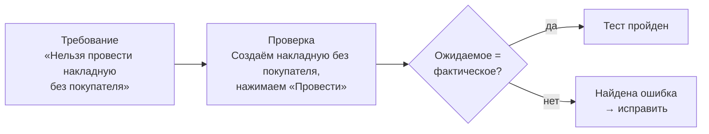
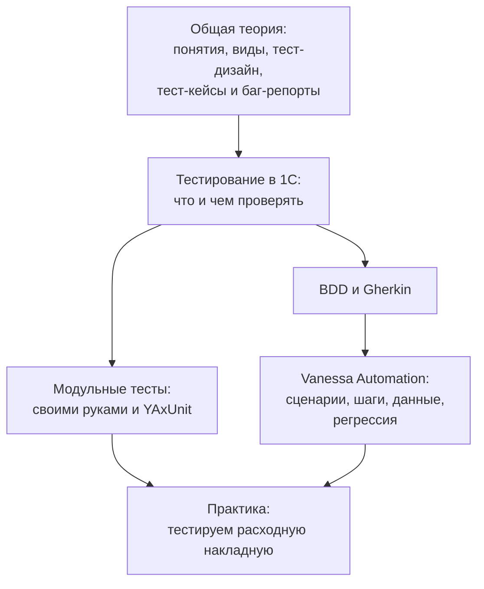

---
tags:
  - 1С/тестирование
---

> [!abstract] Коротко
> **Тестирование** — проверка того, что программа делает то, что от неё ожидают, и не делает того, чего не должна. Ошибки неизбежны: их вносят все разработчики. Чем **позже** найдена ошибка, тем **дороже** её исправление — ошибка в проведении, найденная разработчиком, стоит минуты, а найденная бухгалтером при закрытии квартала — дни работы и испорченные данные. Тестирование не доказывает отсутствие ошибок, но снижает риск. Проверять свой код — обязанность разработчика, а не только тестировщика.

## Почему ошибки неизбежны

Любой программист ошибается: опечатался в имени реквизита, забыл про пустую табличную часть, не подумал, что дата может быть «31 число 00:00». Это не признак плохого специалиста — это свойство сложной работы. Разница между новичком и опытным разработчиком не в том, что опытный не ошибается, а в том, что он **находит** свои ошибки раньше, чем их увидит пользователь.

Примеры ошибок из 1С-практики:

| Ошибка | Чем обернулась |
| --- | --- |
| Сумма строки пересчитывается в форме, но не при записи из обработки | Загруженные накладные с неверными суммами |
| Контроль остатков без блокировки | Два менеджера продали последний товар — остаток −1 |
| Условие периода `Дата <= Конец` без конца дня | Отчёт «теряет» продажи последнего дня месяца |
| Права проверены только под администратором | Кладовщик не может провести приходную накладную |
| Доработка типовой конфигурации сломала печать | Склад неделю печатает накладные вручную |

Каждая из этих ошибок — тема одного из уроков курса. И каждую можно было поймать **проверкой до** передачи доработки пользователям.

## Что такое тестирование

**Тестирование** — это проверка программы: мы выполняем её в заранее продуманных ситуациях и сравниваем **фактическое** поведение с **ожидаемым**.

Аналогия — **техосмотр автомобиля**. Механик не ждёт, пока у вас откажут тормоза на трассе. Он проверяет тормоза, фары, руль по списку, в контролируемых условиях. Если что-то не так — неисправность чинят до того, как она приведёт к аварии.

## Цена ошибки растёт со временем

Чем позже обнаружена ошибка, тем дороже её исправить:

| Когда нашли | Кто нашёл | Чего стоит исправление |
| --- | --- | --- |
| Во время написания кода | Сам разработчик | Минуты |
| На проверке перед сдачей | Разработчик или тестировщик | Часы |
| На тестовой базе у заказчика | Пользователь при приёмке | День, повторная сдача |
| В рабочей базе через месяц | Бухгалтер при закрытии периода | Дни: найти причину, исправить код, **исправить испорченные данные**, перепровести документы |

В 1С последняя строка особенно болезненна: ошибка в проведении успевает записать неверные движения в сотни документов. Исправить код — полдела, исправить накопленные данные — главная работа.

## Тестирование не доказывает отсутствие ошибок

Важная мысль, которую часто спрашивают на собеседованиях: **тестирование может показать наличие ошибок, но не может доказать их отсутствие**. Проверить все возможные комбинации данных невозможно: даже у простой накладной бесконечно много вариантов покупателей, товаров, количеств и дат.

Поэтому цель тестирования — не «проверить всё», а **разумно снизить риск**: проверить самое важное и самое вероятное место для ошибки. Как выбирать такие проверки — в [[04. Техники тест-дизайна]].

## Кто тестирует

| Кто | Что проверяет |
| --- | --- |
| **Разработчик** | Свой код: работает ли доработка, не сломалось ли соседнее. Пишет автоматические тесты |
| **Тестировщик (QA-инженер)** | Систему целиком глазами пользователя; ищет ошибки, которые разработчик не предусмотрел |
| **Аналитик / консультант** | Соответствие требованиям заказчика |
| **Пользователь** | Приёмка: «это то, что мы просили?» |

В небольших 1С-командах отдельного тестировщика часто нет — проверяет сам разработчик. Даже если тестировщик есть, сдавать непроверенный код — плохая практика: «я же не тестировщик» не принимается на ревью.

> [!tip] Привычка, которая отличает хорошего разработчика
> Перед тем как сказать «готово», проверьте доработку **под пользователем с рабочей ролью**, на **новом** документе и на **существующем**, с **корректными** и **ошибочными** данными. Чек-лист самопроверки — в [[05. Профессиональная разработка/11. Стандарты кода и самопроверка|11. Стандарты кода и самопроверка]].

## Ручное и автоматическое тестирование

| | Ручное | Автоматическое |
| --- | --- | --- |
| Как | Человек выполняет шаги и смотрит результат | Программа выполняет шаги и сама сравнивает результат |
| Плюсы | Быстро начать; человек замечает «странное» | Быстро повторить сотни раз; не устаёт и не пропускает шаги |
| Минусы | Долго и скучно повторять; легко пропустить шаг | Нужно время на написание и поддержку тестов |
| Когда | Новая функциональность, исследование, разовые проверки | Регрессия — повторные проверки после каждого изменения |

Автотесты особенно ценны в 1С из-за **регрессии**: доработали проведение расходной накладной — а не сломался ли отчёт, печать, ввод на основании? Вручную проверять всё после каждой правки невозможно, а автотест сделает это за минуты. Об автоматизации 1С — уроки с [[07. Модульные тесты своими руками]] по [[14. Регрессия, отчёты и запуск без участия человека]].

## План раздела

> [!question]- Проверь себя
> 1. Что такое тестирование своими словами?
> 2. Почему ошибка в проведении, найденная через месяц, стоит намного дороже, чем найденная сразу?
> 3. Может ли тестирование доказать, что ошибок нет?
> 4. Для чего особенно полезны автоматические тесты?
>
> > [!success]- Ответы
> > 1. Выполнение программы в продуманных ситуациях и сравнение фактического поведения с ожидаемым.
> > 2. За месяц неверные движения попадут в множество документов: кроме кода придётся исправлять накопленные данные и перепроводить документы.
> > 3. Нет: оно показывает наличие ошибок, но проверить все комбинации данных невозможно. Цель — снизить риск.
> > 4. Для регрессии: быстрой повторной проверки всего важного после каждого изменения.

%% навигация %%

---
← [[07. Тестирование 1С/00. Навигация по разделу|00. Навигация по разделу]] · [[00. Оглавление|⌂ Оглавление]] · [[07. Тестирование 1С/02. Основные понятия тестирования|02. Основные понятия тестирования]] →
