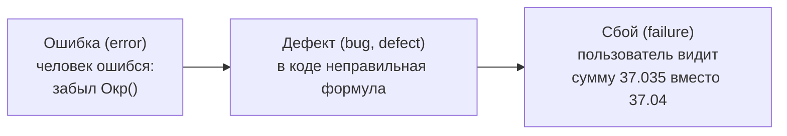

---
tags:
  - 1С/тестирование
---

> [!abstract] Коротко
> **Требование** — что должна делать программа. **Тест** (тест-кейс) — проверка одного поведения: предусловия, шаги, **ожидаемый результат**. Выполнив тест, получаем **фактический результат**; если он отличается от ожидаемого — найден **дефект** (баг). **Ошибка** человека в коде приводит к **дефекту** в программе, а дефект — к **сбою** у пользователя. **Позитивный** тест проверяет нормальную работу, **негативный** — реакцию на неправильные данные. **Регрессия** — когда после изменения ломается то, что раньше работало.

## Словарь тестировщика

Без общего словаря разработчик и тестировщик плохо понимают друг друга. Разберём основные термины на одном примере — расходной накладной из учебной базы.

### Требование

**Требование** — описание того, как должна работать программа. Без требования нельзя сказать, ошибка перед нами или «так и задумано».

> *Требование:* сумма строки товаров равна количеству, умноженному на цену, с округлением до копеек. Накладную нельзя провести без покупателя.

### Тест и тест-кейс

**Тест-кейс** — описание одной проверки: что подготовить, какие действия выполнить и что должно получиться.

| Часть | Пример |
| --- | --- |
| **Название** | Расчёт суммы строки при вводе количества |
| **Предусловия** — что должно быть до начала | Открыта новая расходная накладная, есть товар «Чайник» |
| **Шаги** — что делаем | 1. Добавить строку. 2. Выбрать «Чайник». 3. Ввести цену 150. 4. Ввести количество 2 |
| **Ожидаемый результат** — что должно получиться | Сумма строки = 300 |

Подробно об оформлении — в [[05. Тест-кейсы и баг-репорты]].

### Ожидаемый и фактический результат

- **Ожидаемый результат** — что **должно** получиться по требованию. Записывается **до** выполнения теста.
- **Фактический результат** — что получилось на самом деле.

Совпали — тест **пройден**. Не совпали — тест **не пройден**, найден дефект.

> [!warning] Ожидаемый результат — до запуска
> Если сначала посмотреть, что выдала программа, а потом решить «ну, наверное, так и надо», можно «узаконить» ошибку. Ожидаемый результат записываем заранее, опираясь на требование.

### Ошибка, дефект, сбой

Эти слова в быту путают, а в тестировании различают:

| Термин | Где | Пример |
| --- | --- | --- |
| **Ошибка** | В голове человека | Разработчик забыл, что цену можно ввести с тремя знаками |
| **Дефект (баг)** | В коде или настройках | Нет округления в формуле суммы |
| **Сбой** | Видимое проявление при работе | В печатной форме сумма с тремя знаками после запятой |

Дефект может долго «спать» и проявиться только при определённых данных — например, только когда цена дробная.

## Позитивные и негативные тесты

| Вид | Что проверяет | Пример для накладной |
| --- | --- | --- |
| **Позитивный** | Программа правильно работает с **правильными** данными | Количество 2, цена 150 → сумма 300, документ проводится |
| **Негативный** | Программа правильно **реагирует** на **неправильные** данные и действия | Нет покупателя → понятное сообщение, документ **не** проводится |

Новички проверяют в основном позитивные сценарии: «ввёл нормальные данные — работает». Но пользователи постоянно делают «неправильные» вещи: оставляют поля пустыми, вводят ноль и отрицательные числа, нажимают кнопки дважды. Большая часть дефектов прячется именно в негативных сценариях.

> [!tip] Правило
> На каждый позитивный тест придумайте хотя бы один-два негативных: «а что, если поле пустое? ноль? минус? очень большое число? нет прав?».

## Регрессия

**Регрессия** — ситуация, когда после изменения программы **перестаёт работать то, что раньше работало**.

Пример: мы добавили в проведение расходной накладной контроль остатков ([[05. Профессиональная разработка/02. Контроль остатков и блокировки|02. Контроль остатков]]). Новая проверка работает. Но в коде случайно сломался расчёт движений по регистру продаж — и отчёт по продажам стал показывать нули.

**Регрессионное тестирование** — повторная проверка старой функциональности после изменений. Это самая скучная и самая важная часть тестирования, поэтому её автоматизируют в первую очередь.

## Верификация и валидация

Два похожих вопроса, которые задают на собеседованиях:

| | Вопрос | Пример |
| --- | --- | --- |
| **Верификация** | «Мы **правильно** сделали продукт?» — соответствует ли он требованиям | Сумма строки считается по формуле из ТЗ |
| **Валидация** | «Мы сделали **правильный** продукт?» — решает ли он задачу пользователя | Кладовщику действительно удобно вводить накладные |

Программа может идеально соответствовать требованиям и всё равно оказаться бесполезной, если требования были неверными.

## Покрытие

**Покрытие** — насколько полно тесты проверяют программу. Его оценивают по-разному:

| Покрытие | Вопрос |
| --- | --- |
| Требований | Для каждого ли требования есть тест? |
| Кода | Какая доля строк кода выполнилась при прогоне тестов? |
| Сценариев | Проверены ли основные пути пользователя? |

Стопроцентное покрытие кода не означает отсутствия ошибок: строка выполнилась, но с одним набором данных, а с другим может сломаться.

## Семь принципов тестирования

Эти принципы часто спрашивают на собеседованиях по тестированию:

1. **Тестирование показывает наличие дефектов**, а не их отсутствие.
2. **Исчерпывающее тестирование невозможно** — проверить все комбинации нельзя, нужно выбирать.
3. **Раннее тестирование** экономит время и деньги — чем раньше нашли, тем дешевле.
4. **Скопление дефектов**: большинство ошибок обычно сосредоточено в небольшой части программы (сложное проведение, интеграции).
5. **Парадокс пестицида**: если повторять одни и те же тесты, они перестают находить новые ошибки — тесты нужно обновлять.
6. **Тестирование зависит от контекста**: банковскую систему и сайт-визитку проверяют по-разному.
7. **Заблуждение об отсутствии ошибок**: программа без ошибок, которая не нужна пользователю, — всё равно плохая программа.

> [!question]- Проверь себя
> 1. Из каких частей состоит тест-кейс?
> 2. Почему ожидаемый результат нужно записать до выполнения теста?
> 3. Чем ошибка отличается от дефекта и сбоя?
> 4. Приведите негативный тест для поля «Количество» в строке накладной.
> 5. Что такое регрессия?
>
> > [!success]- Ответы
> > 1. Название, предусловия, шаги, ожидаемый результат.
> > 2. Чтобы не подогнать «ожидание» под фактический результат программы и не узаконить ошибку.
> > 3. Ошибка — промах человека; дефект — неправильность в коде; сбой — видимое проявление дефекта при работе.
> > 4. Ввести количество 0 или −1 и попытаться провести — ожидаем сообщение об ошибке и отказ в проведении.
> > 5. Поломка ранее работавшей функциональности после изменения программы.

%% навигация %%

---
← [[07. Тестирование 1С/01. Зачем нужно тестирование|01. Зачем нужно тестирование]] · [[07. Тестирование 1С/00. Навигация по разделу|↑ Раздел]] · [[00. Оглавление|⌂ Оглавление]] · [[07. Тестирование 1С/03. Виды и уровни тестирования|03. Виды и уровни тестирования]] →
