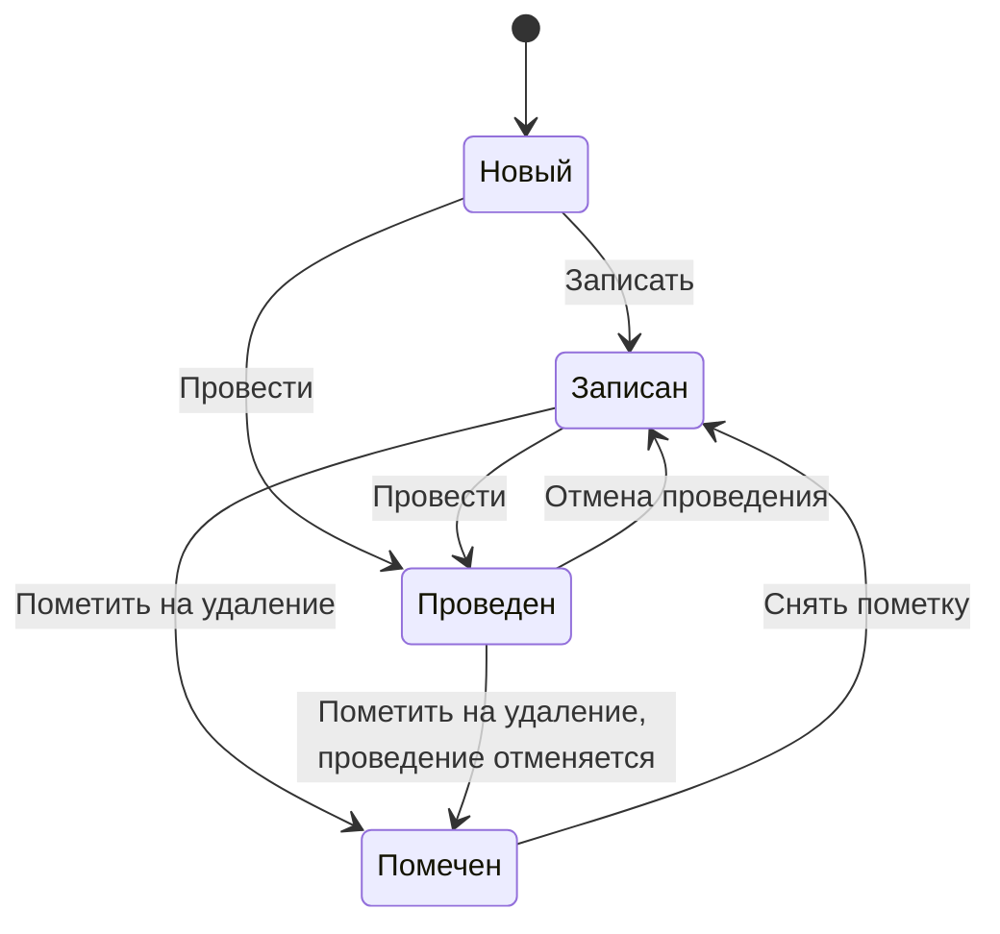

---
tags:
  - 1С/тестирование
---

> [!abstract] Коротко
> **Тест-дизайн** — способ придумать **мало** тестов, которые найдут **много** ошибок. **Классы эквивалентности**: разбиваем возможные значения на группы, внутри которых программа ведёт себя одинаково, и берём по одному представителю. **Граничные значения**: ошибки чаще всего прячутся на границах — проверяем значение на границе и рядом с ней (0, 1, −1; 100 и 101). **Таблица решений** — все комбинации условий, влияющих на результат. **Переходы состояний** — проверяем допустимые и недопустимые смены состояния (записан → проведён → помечен на удаление). **Предугадывание ошибок** — опыт: пустые поля, двойное нажатие, конец месяца.

## Зачем нужен тест-дизайн

Поле «Количество» в строке накладной. Сколько разных значений можно ввести? Бесконечно много: 1, 2, 3…, 1.5, 0, −7, 999999… Проверить все невозможно ([[02. Основные понятия тестирования]]). Нужен способ выбрать **несколько** значений так, чтобы они «покрыли» все типичные ошибки. Этим и занимается тест-дизайн.

Разберём основные техники на одном требовании:

> **Требование.** Количество в строке расходной накладной должно быть больше 0 и не больше 1000. При количестве от 100 включительно действует оптовая скидка 5%.

## Техника 1. Классы эквивалентности

**Идея.** Все возможные значения делим на **группы (классы)**, внутри которых программа должна вести себя **одинаково**. Если она правильно работает для одного значения из группы, то, скорее всего, правильно и для остальных. Значит, из каждой группы достаточно взять **одного представителя**.

Аналогия: чтобы проверить, все ли яблоки в ящике спелые, не надо пробовать каждое — достаточно попробовать по одному из каждой партии.

Для нашего требования:

```text
   ←───────┼──────────────────┼────────────────────┼──────────→
  ≤ 0      │   1 … 99          │   100 … 1000        │   > 1000
недопустимо│  допустимо,       │  допустимо,         │ недопустимо
           │  без скидки       │  со скидкой 5%      │
```

| Класс | Ожидаемое поведение | Представитель |
| --- | --- | --- |
| Меньше или равно 0 | Ошибка, запись запрещена | −5 |
| От 1 до 99 | Записывается, без скидки | 50 |
| От 100 до 1000 | Записывается, скидка 5% | 500 |
| Больше 1000 | Ошибка, запись запрещена | 5000 |

Четыре теста вместо бесконечного числа. Ещё есть «неожиданные» классы: **пустое значение**, **дробное** количество (1.5 — допустимо ли по требованию?). Такие вопросы стоит задать аналитику.

## Техника 2. Граничные значения

**Идея.** Программисты чаще всего ошибаются **на границах**: пишут `<` вместо `<=`, `>` вместо `>=`. Поэтому проверяем значения **на** границе и **по обе стороны** от неё.

Помните ошибку с периодом `Дата <= Конец` без времени конца дня? Это классическая ошибка на границе ([[03. Язык запросов и СКД/05. Параметры и границы периода|05. Границы периода]]).

| Граница | Проверяем | Ожидаем |
| --- | --- | --- |
| Нижняя граница допустимого (0 / 1) | 0 | Ошибка |
| | 1 | Записывается |
| Граница скидки (99 / 100) | 99 | Без скидки |
| | 100 | Со скидкой |
| Верхняя граница (1000 / 1001) | 1000 | Записывается |
| | 1001 | Ошибка |

Если в коде написано `Если Количество > 100 Тогда` (скидка со **101**), тест со значением **100** сразу покажет ошибку — а тест со значением 500 её бы не заметил.

> [!tip] Классы + границы вместе
> Обычно их используют в паре: классы эквивалентности дают «середины» групп, граничные значения — края. Для нашего требования получаем около 8–10 тестов, которые ловят почти все типичные ошибки в условии.

## Техника 3. Таблица решений

**Идея.** Когда результат зависит от **нескольких условий одновременно**, выписываем все их комбинации в таблицу — так не пропустим ни одну.

**Требование.** Накладную можно провести, если выбран покупатель **и** есть хотя бы одна строка товаров или услуг **и** у пользователя есть право «Проведение».

| Комбинация | Покупатель выбран | Есть строки | Есть право | Ожидаемый результат |
| --- | --- | --- | --- | --- |
| 1 | Да | Да | Да | **Проводится** |
| 2 | Нет | Да | Да | Сообщение «Выберите покупателя» |
| 3 | Да | Нет | Да | Сообщение «Добавьте товары или услуги» |
| 4 | Да | Да | Нет | Кнопки «Провести» нет / ошибка прав |
| 5 | Нет | Нет | Да | Сообщение об ошибке (какое первым?) |
| … | | | | |

Три условия «да/нет» — `2³ = 8` комбинаций. Таблица заставляет подумать о случаях, о которых легко забыть, — например, комбинация 5: какое сообщение показать, если ошибок две? Хорошо, если ответ есть в требованиях; если нет — это вопрос аналитику.

## Техника 4. Переходы состояний

**Идея.** У многих объектов есть **состояния** и правила перехода между ними. Проверяем и разрешённые, и **запрещённые** переходы.

Документ в 1С ([[01. Основы конфигурирования/14. Документы|14. Документы]]):



| Переход | Что проверяем |
| --- | --- |
| Записан → Проведён | Движения появились в регистрах |
| Проведён → Записан (отмена проведения) | Движения **исчезли** |
| Проведён → Проведён (повторное проведение) | Движения **не задвоились** |
| Проведён → Помечен на удаление | Проведение отменилось, движения удалены |
| Помечен → (снять пометку) | Документ записан, но **не** проведён |

Повторное проведение и отмена проведения — частые места ошибок в доработках проведения ([[01. Основы конфигурирования/17. Регистры накоплений|17. Регистры накоплений]]).

## Техника 5. Предугадывание ошибок

**Идея.** Опыт подсказывает, где обычно ломается. Это не формальная техника, а **список типичных подозрительных мест**, который стоит держать под рукой.

Для 1С:

| Где ломается | Что проверить |
| --- | --- |
| Пустые значения | Пустой покупатель, пустая табличная часть, пустая дата |
| Ноль и отрицательные | Количество 0, цена −1, сумма 0 |
| Даты | Последний день месяца, конец дня 23:59:59, документ «задним числом», 29 февраля |
| Повторные действия | Двойное нажатие «Провести», повторное проведение, ввод на основании дважды |
| Права | Под пользователем без административных прав |
| Объём | 1 строка и 500 строк, пустой справочник |
| Одновременная работа | Два пользователя проводят расход последнего товара ([[05. Профессиональная разработка/02. Контроль остатков и блокировки|02. Контроль остатков]]) |
| Длинные значения | Длинное наименование товара в печатной форме |
| Копирование | Скопированный документ — не тянет ли он старые ссылки |

## Как это применять на практике

Получив задачу на доработку:
1. Выпишите **требования** по пунктам.
2. Для каждого числового или датового поля — **классы и границы**.
3. Для правил с несколькими условиями — **таблица решений**.
4. Для документов — **переходы состояний** (запись, проведение, отмена, пометка).
5. Пройдитесь по списку **предугадывания ошибок**.

Получится короткий, но сильный список проверок — основа тест-кейсов ([[05. Тест-кейсы и баг-репорты]]).

> [!question]- Проверь себя
> 1. Скидка действует «от 1000 рублей включительно». Какие значения суммы проверить по технике граничных значений?
> 2. Что такое класс эквивалентности и сколько тестов нужно на класс?
> 3. Когда удобна таблица решений?
> 4. Какие переходы состояний документа особенно важно проверить после доработки проведения?
>
> > [!success]- Ответы
> > 1. 999.99 (без скидки), 1000 (со скидкой), можно ещё 1000.01.
> > 2. Группа значений, на которых программа ведёт себя одинаково; обычно один представитель на класс.
> > 3. Когда результат зависит от комбинации нескольких условий.
> > 4. Повторное проведение (движения не задваиваются), отмена проведения (движения удаляются), пометка на удаление проведённого.

%% навигация %%

---
← [[07. Тестирование 1С/03. Виды и уровни тестирования|03. Виды и уровни тестирования]] · [[07. Тестирование 1С/00. Навигация по разделу|↑ Раздел]] · [[00. Оглавление|⌂ Оглавление]] · [[07. Тестирование 1С/05. Тест-кейсы и баг-репорты|05. Тест-кейсы и баг-репорты]] →
