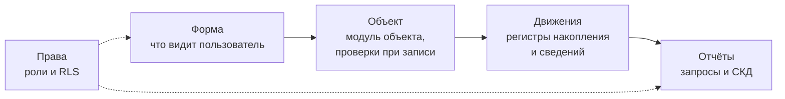

---
tags:
  - 1С/тестирование
---

> [!abstract] Коротко
> В 1С проверяют не только «что видно в форме», но и **данные под капотом**: движения регистров после проведения и отмены, результат запросов и отчётов, работу **под разными ролями**, поведение **без формы** (обработки, обмены). Инструменты: **ручные** проверки по чек-листам; **модульные** тесты — своей тестовой обработкой или фреймворком **YAxUnit**; **сценарные UI-тесты** — **Vanessa Automation** (сценарии на языке Gherkin, выполняются в клиенте тестирования); встроенный в платформу механизм **автоматизированного тестирования** (менеджер и клиент тестирования), на котором Vanessa Automation и работает. Для всех автотестов нужна отдельная **тестовая база** с известными данными.

## Что особенного в тестировании 1С

В обычной программе тестировщик смотрит на экран: правильная ли надпись, правильная ли сумма. В 1С этого мало: самая важная часть работы — **данные в регистрах**, которые пользователь напрямую не видит. Накладная может выглядеть идеально, но записать неверные движения — и это всплывёт только в отчёте через месяц.

## Что проверять в 1С

| Что | Как проверить | Пример |
| --- | --- | --- |
| **Форма** | Ввести данные, посмотреть пересчёт, сообщения, доступность полей | Сумма строки пересчитывается при вводе |
| **Запись без формы** | Записать объект кодом или обработкой | Обработка загрузки создаёт накладную — суммы и проверки работают |
| **Проведение** | Посмотреть **движения** документа | После проведения в регистре `Продажи` строка на 300 ₽ |
| **Повторное проведение** | Провести дважды, сравнить движения | Движения не задвоились |
| **Отмена проведения** | Отменить, посмотреть регистры | Движения исчезли |
| **Отчёты** | Сравнить итог отчёта с известными данными | Продажи за октябрь = сумма проведённых накладных |
| **Границы периода** | Документ в последний день, в 23:59 | Отчёт за месяц включает продажи 31 числа |
| **Права** | Войти под пользователем с рабочей ролью | Кладовщик не видит цены, менеджер не может удалить документ |
| **Одновременная работа** | Два сеанса проводят расход одного товара | Остаток не уходит в минус |
| **Печать** | Сформировать печатную форму с 1 и 100 строками | Итог совпадает, страницы переносятся |
| **Обновление** | После обновления типовой — проверить свои доработки | Расширение применилось, сценарии работают |

### Как посмотреть движения документа

Самый частый вопрос при проверке проведения — «а что документ записал в регистры?». В 1С:Предприятии:
- открыть документ → **Ещё → Перейти → Движения документа** (если в конфигурации включено) или
- **Сервис и настройки → Функции для технического специалиста → Регистры накопления → Продажи** и отобрать по регистратору ([[01. Основы конфигурирования/17. Регистры накоплений|17. Регистры накоплений]]).

Удобнее всего — небольшой отчёт или запрос к таблице регистра с отбором по регистратору: его можно использовать и при ручной, и при автоматической проверке.

## Инструменты тестирования в 1С

| Инструмент | Что это | Уровень пирамиды | Где разобран |
| --- | --- | --- | --- |
| **Ручная проверка** по чек-листу | Человек выполняет шаги | Любой | [[05. Тест-кейсы и баг-репорты]] |
| **Своя тестовая обработка** | Внешняя обработка с функциями-проверками | Модульные, интеграционные | [[07. Модульные тесты своими руками]] |
| **YAxUnit** | Фреймворк модульных тестов в виде расширения конфигурации | Модульные, интеграционные | [[08. Модульные тесты в YAxUnit]] |
| **Vanessa Automation** | Открытый инструмент сценарного тестирования интерфейса: сценарии на языке Gherkin выполняются в клиенте тестирования | UI / сквозные, приёмочные | [[10. Vanessa Automation — установка и запуск]] и далее |
| **Механизм автоматизированного тестирования платформы** | Режимы «менеджер тестирования» и «клиент тестирования»: одна программа управляет другой, нажимая кнопки и заполняя поля | Основа UI-тестов | [[10. Vanessa Automation — установка и запуск]] |
| **Сценарное тестирование 1С** | Инструмент фирмы 1С для записи и воспроизведения сценариев | UI | Упоминание |
| **АПК, BSL Language Server** | Автоматическая проверка **кода** по стандартам без запуска | Статический анализ | [[05. Профессиональная разработка/10. Хранилище, EDT и Git|10. Инструменты качества]] |

> [!info] Почему в курсе основной инструмент — Vanessa Automation
> Vanessa Automation — бесплатный открытый проект, широко распространённый в 1С-сообществе: его используют и для автотестов, и для приёмочных сценариев, понятных аналитикам и заказчикам, и даже для записи обучающих видеоинструкций. Знание этого инструмента часто упоминают в вакансиях.

## Тестовая база и тестовые данные

Автотест должен запускаться **много раз** и каждый раз давать одинаковый результат. Поэтому:

| Правило | Почему |
| --- | --- |
| Тесты запускаем в **отдельной тестовой базе**, не в рабочей | Тесты создают и проводят документы — в рабочей базе они испортят учёт |
| Данные для теста известны заранее | Ожидаемый результат можно посчитать: «остаток 10, продали 3 → 7» |
| Тест не зависит от других тестов | Если тест А сломался, тест Б не должен падать «за компанию» |
| После теста база возвращается в исходное состояние (или тест создаёт свои уникальные данные) | Следующий запуск не должен видеть «мусор» от предыдущего |

Подробно о подготовке данных — в [[13. Тестовые данные и независимость сценариев]].

> [!warning] Никогда не запускайте автотесты на рабочей базе
> Сценарий, который «создаёт и проводит накладную на 1000 чайников», в рабочей базе создаст настоящую накладную и испортит остатки. Перед запуском тестов проверяйте, к какой базе вы подключены.

## Ограничения учебной платформы

Учебная версия платформы разрешает работать с базой только **одному сеансу** ([[05. Профессиональная разработка/02. Контроль остатков и блокировки|02. Ограничения учебной версии]]). Для UI-тестов нужно **два** сеанса одновременно: один управляет (менеджер тестирования), другой — управляемое приложение (клиент тестирования). Поэтому:

| Что | На учебной платформе |
| --- | --- |
| Ручные проверки | Работают |
| Своя тестовая обработка с модульными тестами | Работает |
| Изучение языка Gherkin и написание сценариев | Работает — это просто текст |
| Запуск сценариев Vanessa Automation в клиенте тестирования | Скорее всего **не** заработает — нужен стенд с полноценной платформой |

Это не мешает изучить раздел: теорию, модульные тесты и написание сценариев можно отработать на учебной платформе, а запуск UI-сценариев — на рабочем стенде или в компании.

> [!question]- Проверь себя
> 1. Почему в 1С недостаточно проверить только то, что видно в форме?
> 2. Какие три состояния проведения документа стоит проверять после доработки?
> 3. Какой инструмент подходит для модульных тестов, а какой — для сценарных тестов интерфейса?
> 4. Почему автотесты нельзя запускать на рабочей базе?
>
> > [!success]- Ответы
> > 1. Главное — данные в регистрах; форма может выглядеть правильно, а движения быть неверными. Кроме того, документ может записываться без формы.
> > 2. Проведение, повторное проведение (без задвоения) и отмена проведения (движения удалены).
> > 3. Модульные — своя тестовая обработка или YAxUnit; сценарные UI — Vanessa Automation.
> > 4. Тесты создают и проводят документы — в рабочей базе они испортят реальный учёт.

%% навигация %%

---
← [[07. Тестирование 1С/05. Тест-кейсы и баг-репорты|05. Тест-кейсы и баг-репорты]] · [[07. Тестирование 1С/00. Навигация по разделу|↑ Раздел]] · [[00. Оглавление|⌂ Оглавление]] · [[07. Тестирование 1С/07. Модульные тесты своими руками|07. Модульные тесты своими руками]] →
