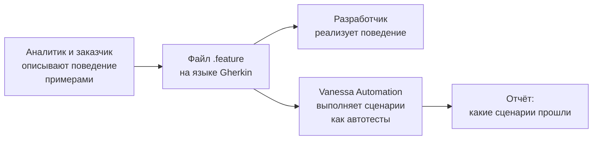

---
tags:
  - 1С/тестирование
---

> [!abstract] Коротко
> **BDD** (разработка через поведение) — подход, при котором требования записываются как **сценарии поведения** программы на понятном человеку языке, а затем эти же сценарии выполняются как автотесты. Язык записи — **Gherkin**: файл `.feature` с блоками **Функционал** (что за возможность), **Контекст** (общая подготовка), **Сценарий** (один пример поведения) и шагами **Дано** (исходное состояние) → **Когда** (действие) → **Тогда** (ожидаемый результат), плюс **И** / **Но** для продолжения. **Структура сценария** с таблицей **Примеры** запускает один сценарий на нескольких наборах данных. Vanessa Automation выполняет такие файлы в 1С.

## Проблема: требования и тесты живут отдельно

Обычно бывает так: аналитик пишет требования в документе Word, разработчик читает их и пишет код, тестировщик пишет тест-кейсы в таблице. Три разных текста об одном и том же — и они расходятся: требование уточнили, а тест-кейсы забыли поправить.

**BDD** (Behaviour-Driven Development — разработка через поведение) предлагает другое: описать поведение **один раз** в виде конкретных примеров, понятных всем — заказчику, аналитику, разработчику, тестировщику. И сделать так, чтобы эти примеры **выполнялись** как автотесты.



Сценарий становится одновременно **требованием**, **документацией** и **тестом**.

## Язык Gherkin

**Gherkin** — простой язык описания сценариев. Его ключевые слова есть и на английском, и на русском. В 1С-проектах обычно пишут по-русски.

Первая строка файла указывает язык:

```gherkin
#language: ru
```

Vanessa Automation может сама создать заготовку файла — с директивой языка, меткой, заголовком функционала, описанием «Как … я хочу …» и пустым сценарием:

![[VA-02-Редактор-feature-шаблон.png]]

*Встроенный редактор Vanessa Automation после команды «Быстро создать временный feature файл»: шаблон с ключевыми словами Gherkin, подсветка синтаксиса и нумерация строк.*

### Пример полного файла

```gherkin
#language: ru

Функционал: Расчёт суммы в расходной накладной
	Как менеджер по продажам
	Я хочу, чтобы сумма строки считалась автоматически
	Чтобы не ошибаться при ручном расчёте

Контекст:
	Дано в базе есть товар "Чайник"
	И в базе есть покупатель "Ромашка"

Сценарий: Сумма строки равна количеству, умноженному на цену
	Дано я создал новую расходную накладную
	Когда я добавляю строку с товаром "Чайник", количеством 2 и ценой 150
	Тогда сумма строки равна 300
	И итог товаров равен 300

Сценарий: Накладную нельзя провести без покупателя
	Дано я создал новую расходную накладную
	И поле "Покупатель" не заполнено
	Когда я нажимаю "Провести и закрыть"
	Тогда появляется сообщение "Выберите покупателя"
	И форма накладной остаётся открытой
```

Такой текст понятен без знания программирования — его можно показать заказчику и спросить: «Мы правильно поняли, как должно работать?».

## Ключевые слова

| Ключевое слово | Английский аналог | Смысл |
| --- | --- | --- |
| `Функционал:` | Feature | Название возможности программы, которую описывает файл. Ниже — свободное описание: кто, что и зачем |
| `Контекст:` | Background | Шаги, которые выполняются **перед каждым** сценарием файла — общая подготовка |
| `Сценарий:` | Scenario | Один конкретный пример поведения |
| `Дано` | Given | **Исходное состояние**: что есть до действия |
| `Когда` | When | **Действие** пользователя или системы |
| `Тогда` | Then | **Ожидаемый результат** |
| `И`, `Но` | And, But | Продолжение предыдущего типа шага |
| `Структура сценария:` | Scenario Outline | Шаблон сценария, который запускается для каждой строки таблицы `Примеры` |
| `Примеры:` | Examples | Таблица данных для структуры сценария |
| `@метка` | Tag | Метка для группировки и отбора сценариев |
| `#` | — | Комментарий |

Отступы — табуляция или пробелы — только для читаемости.

### Дано — Когда — Тогда

Это тот же принцип, что «Подготовка — Действие — Проверка» в модульных тестах ([[07. Модульные тесты своими руками]]), только на человеческом языке:

| Шаг | Вопрос | Пример |
| --- | --- | --- |
| **Дано** | В каком состоянии программа до начала? | Дано открыта новая расходная накладная |
| **Когда** | Что делает пользователь? | Когда я ввожу количество 2 |
| **Тогда** | Что должно получиться? | Тогда сумма строки равна 300 |

> [!tip] Один сценарий — одно поведение
> Хороший сценарий проверяет **одно** правило и содержит обычно одно «Когда». Если в сценарии три «Когда» и пять «Тогда», скорее всего, это несколько сценариев, склеенных в один.

## Структура сценария и примеры

Когда одно и то же поведение нужно проверить на разных данных — например, на граничных значениях ([[04. Техники тест-дизайна]]), — не копируем сценарий, а пишем **шаблон** с таблицей:

```gherkin
Структура сценария: Скидка зависит от количества
	Дано я создал новую расходную накладную
	Когда я добавляю строку с товаром "Чайник", количеством <Количество> и ценой 10
	Тогда сумма строки равна <Сумма>

	Примеры:
		| Количество | Сумма |
		| 99         | 990   |
		| 100        | 950   |
		| 101        | 959.5 |
```

Сценарий выполнится три раза: в каждом запуске `<Количество>` и `<Сумма>` заменяются значениями из очередной строки таблицы.

## Таблицы в шагах

Шаг может принимать таблицу — например, список строк документа:

```gherkin
Когда я добавляю в накладную товары:
	| Товар  | Количество | Цена |
	| Чайник | 2          | 150  |
	| Кружка | 3          | 50   |
Тогда итог товаров равен 450
```

## Метки

Метки (теги) пишутся перед `Функционал` или `Сценарий` и позволяют выбирать, что запускать:

```gherkin
@smoke
@продажи
Сценарий: Накладная с одной строкой проводится
```

Например, перед каждой сборкой запускают только сценарии с меткой `@smoke` (дымовые тесты, [[03. Виды и уровни тестирования]]), а ночью — все.

## Как текст превращается в действия

Сам по себе Gherkin — просто текст. Чтобы шаг «Когда я нажимаю "Провести и закрыть"» что-то сделал, инструмент должен знать, **какой код** выполнить для этой фразы. В Vanessa Automation это решается двумя способами:

| Способ | Что это |
| --- | --- |
| **Библиотека стандартных шагов** | Сотни готовых фраз для работы с формами: открыть раздел, нажать кнопку, ввести значение в поле, проверить таблицу. Их можно использовать сразу, без программирования |
| **Свои шаги** | Для фразы пишется процедура на встроенном языке — например, «в базе есть товар "Чайник"», которая создаёт элемент справочника |

Поэтому шаги из примера выше — «я добавляю строку с товаром…» — это пока **описание на языке заказчика**. В следующих уроках мы запишем такой сценарий **стандартными шагами** Vanessa Automation, которые она умеет выполнять ([[11. Первый сценарий в Vanessa Automation]]).

> [!info] Два стиля сценариев
> - **Декларативный** — на языке бизнеса: «Когда я провожу накладную на 2 чайника». Хорош для требований и общения с заказчиком.
> - **Императивный** — пошагово по интерфейсу: «И я нажимаю на кнопку с именем "ФормаПровести"». Его выполняют стандартные шаги без программирования.
> На практике часто комбинируют: для ключевых действий заводят свои «бизнес-шаги», внутри которых — стандартные интерфейсные.

> [!question]- Проверь себя
> 1. Что означает BDD и чем этот подход полезен?
> 2. Чем `Контекст` отличается от обычного `Сценарий`?
> 3. Распределите по Дано / Когда / Тогда: «итог равен 300», «открыта новая накладная», «я ввожу количество 2».
> 4. Как проверить один сценарий на пяти наборах данных, не копируя его?
> 5. Для чего нужны метки?
>
> > [!success]- Ответы
> > 1. Разработка через поведение: требования записываются примерами поведения на понятном языке, и эти примеры выполняются как автотесты — один текст служит требованием, документацией и тестом.
> > 2. Шаги `Контекст` выполняются перед каждым сценарием файла; это общая подготовка, а не самостоятельная проверка.
> > 3. Дано — «открыта новая накладная»; Когда — «я ввожу количество 2»; Тогда — «итог равен 300».
> > 4. `Структура сценария` с таблицей `Примеры`.
> > 5. Чтобы группировать и выборочно запускать сценарии (например, только дымовые `@smoke`).

%% навигация %%

---
← [[07. Тестирование 1С/08. Модульные тесты в YAxUnit|08. Модульные тесты в YAxUnit]] · [[07. Тестирование 1С/00. Навигация по разделу|↑ Раздел]] · [[00. Оглавление|⌂ Оглавление]] · [[07. Тестирование 1С/10. Vanessa Automation — установка и запуск|10. Vanessa Automation — установка и запуск]] →
