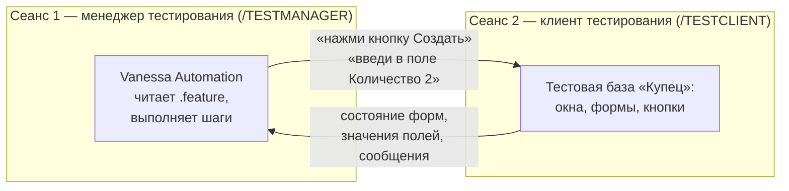

---
tags:
  - 1С/тестирование
---

> [!abstract] Коротко
> **Vanessa Automation** (VA) — бесплатный открытый инструмент для BDD-тестирования 1С: внешняя обработка `vanessa-automation.epf` (или однофайловая `vanessa-automation-single.epf`) из релизов проекта на GitHub. Работает поверх механизма автоматизированного тестирования платформы: VA открывается в сеансе **менеджера тестирования** (ключ запуска `/TESTMANAGER`) и управляет вторым сеансом — **клиентом тестирования** (`/TESTCLIENT`), где «пользователь-робот» нажимает кнопки и заполняет поля. Сценарии хранятся в файлах `.feature`. Для работы нужна отдельная **тестовая база** и платформа, допускающая **два** одновременных сеанса.

## Что такое Vanessa Automation

**Vanessa Automation** — инструмент, который читает сценарии на языке Gherkin ([[09. BDD и язык Gherkin]]) и **выполняет их в 1С**: открывает разделы, создаёт документы, заполняет поля, нажимает кнопки и проверяет результат — как живой пользователь, только быстро и без ошибок внимания.

| Свойство | Что значит |
| --- | --- |
| Бесплатный и открытый | Исходный код на GitHub: [github.com/Pr-Mex/vanessa-automation](https://github.com/Pr-Mex/vanessa-automation), документация: [pr-mex.github.io/vanessa-automation](https://pr-mex.github.io/vanessa-automation/dev/) |
| Внешняя обработка | Не нужно менять конфигурацию — файл `.epf` открывается в любой базе ([[01. Основы конфигурирования/23. Обработки и внешние файлы|23. Внешние обработки]]) |
| Библиотека шагов | Сотни готовых шагов для работы с формами — тесты можно писать без программирования |
| Запись действий | Можно «прокликать» сценарий руками, а VA превратит действия в шаги |
| Отчёты | Результаты прогона в виде отчётов, в том числе для CI ([[14. Регрессия, отчёты и запуск без участия человека]]) |

## Как это работает: менеджер и клиент тестирования

В платформе 1С есть встроенный механизм **автоматизированного тестирования**. Он позволяет одному сеансу 1С:Предприятия **управлять** другим:



| Роль | Ключ запуска | Что делает |
| --- | --- | --- |
| **Менеджер тестирования** (TestManager) | `/TESTMANAGER` | В нём открыта Vanessa Automation; он отдаёт команды |
| **Клиент тестирования** (TestClient) | `/TESTCLIENT` | Обычное окно приложения, которым управляют «снаружи» |

Аналогия — **пульт и телевизор**: VA — пульт, клиент тестирования — телевизор. Пульт сам ничего не показывает, а только нажимает кнопки на телевизоре и смотрит, что изменилось на экране.

Поэтому для запуска сценариев нужны **два одновременных сеанса** 1С.

> [!warning] Учебная платформа
> Учебная версия платформы допускает только **один** сеанс работы с базой. Запуск клиента тестирования рядом с менеджером на ней, скорее всего, не получится. Изучить интерфейс VA, загрузить и прочитать сценарии, написать свои `.feature`-файлы можно и на учебной платформе, а **выполнять** сценарии — на стенде с полноценной платформой (на работе, на стажировке, на демо-стенде). Остальные уроки раздела написаны так, чтобы их можно было пройти и без запуска.

## Установка

1. Откройте страницу релизов: [github.com/Pr-Mex/vanessa-automation/releases](https://github.com/Pr-Mex/vanessa-automation/releases).
2. Скачайте архив последнего релиза и распакуйте в отдельный каталог, например `C:\VA\`.
3. В каталоге найдите обработку:
   - `vanessa-automation.epf` — основная сборка (рядом лежат её вспомогательные файлы и библиотеки шагов — каталог не разбирать);
   - или `vanessa-automation-single.epf` — та же функциональность **в одном файле**; удобна, если нужно просто открыть и работать.
4. Подготовьте **тестовую базу**: копию учебной базы через выгрузку и загрузку `.dt` в новую пустую базу ([[01. Основы конфигурирования/28. Резервные копии и обслуживание базы|28. Резервные копии]]). Назовите её, например, «Купец (тест)».

> [!warning] Только тестовая база
> Сценарии создают и проводят документы. Подключайте клиент тестирования **только** к тестовой базе ([[06. Что и чем тестировать в 1С]]).

## Запуск

### Шаг 1. Запустить менеджер тестирования

Vanessa Automation должна работать в сеансе, запущенном в режиме менеджера тестирования. Проще всего — указать ключ в параметрах базы в окне запуска 1С:

1. В окне запуска выделите базу, откуда будете запускать VA (это может быть та же тестовая или любая другая база) → **Изменить…** → дойдите до страницы с **дополнительными параметрами запуска**.
2. Впишите `/TESTMANAGER`.
3. Запустите **1С:Предприятие** этой базы.

Или из командной строки:

```bash
"C:\Program Files\1cv8\<версия>\bin\1cv8c.exe" ENTERPRISE /IBName "Купец (тест)" /TESTMANAGER
```

### Шаг 2. Открыть Vanessa Automation

В 1С:Предприятии: **Файл → Открыть** (`Ctrl+O`) → выберите `vanessa-automation.epf` (или `-single`). При первом запуске VA может предложить установить свою внешнюю компоненту для расширенных возможностей (работа с окнами, снимки экрана) — согласитесь, если работаете на своём стенде.

![[VA-01-Стартовая-страница.png]]

*Vanessa Automation 1.2.043.47 (сборка single), открытая в сеансе менеджера тестирования учебной базы: стартовая страница со ссылками «Создать / Открыть feature файл», «Открыть папку», «Быстро создать временный feature файл», вверху — панель команд, справа — закладки «Запуск сценариев», «Библиотеки», «Клиенты тестирования» и другие.*

### Шаг 3. Подключить клиент тестирования

В Vanessa Automation есть настройка **клиентов тестирования** — список баз, которыми она может управлять:

1. Откройте настройки клиентов тестирования (закладка или раздел «Клиенты тестирования»).
2. Добавьте клиент: укажите **строку подключения** к тестовой базе (файловая база — путь к каталогу), пользователя и пароль тестового пользователя.
3. Нажмите кнопку запуска или подключения клиента — VA сама запустит вторую 1С с ключом `/TESTCLIENT` и подключится к ней.

![[VA-05-Клиенты-тестирования.png]]

*Закладка «Клиенты тестирования»: клиент «Этот клиент», тип «Тонкий», путь к информационной базе, дополнительные параметры запуска (пользователь), компьютер и порт, на котором VA общается с клиентом.*

Стандартный первый шаг большинства сценариев тоже умеет подключаться к клиенту:

```gherkin
Дано Я открыл новый сеанс TestClient или подключил уже существующий
```

### Шаг 4. Загрузить и выполнить сценарий

1. Кнопкой загрузки откройте файл `.feature` или каталог с ними. В дереве появятся функционал, сценарии и шаги.
2. Нажмите **«Выполнить сценарии»**. VA пройдёт шаги по очереди; в окне клиента тестирования видно, как «сами» открываются формы и заполняются поля.
3. Результат каждого шага подсвечивается цветом.

![[VA-04-Шаг-с-ошибкой-TestClient.png]]

*Попытка выполнить сценарий на учебной платформе: шаг «Дано Я открыл новый сеанс TestClient…» подсвечен красным — «Не получилось подключить TestClient», внизу в сообщениях «Прерывание по таймауту». Второй сеанс для клиента тестирования учебная платформа не дала — ровно то ограничение, о котором шла речь выше. Под красным шагом — ссылки «Детали», «Актуализировать», «Скопировать текст ошибки».*

| Цвет шага | Значит |
| --- | --- |
| Зелёный | Шаг выполнен успешно |
| Красный | Шаг упал: проверка не прошла или элемент не найден — рядом текст ошибки |
| Жёлтый / серый | Шаг не реализован (для фразы нет кода) или не выполнялся |

## Основные возможности интерфейса

| Возможность | Зачем |
| --- | --- |
| Дерево сценариев | Видно все сценарии и шаги загруженных файлов |
| Выполнить все / выбранный сценарий | Прогон целиком или выборочно |
| Выполнить с текущего шага | Продолжить после исправления, не начиная сначала — удобно при отладке |
| Поиск и вставка известных шагов | Библиотека шагов: найти нужную фразу и вставить в сценарий ([[12. Шаги, проверки и запись действий]]) |
| Запись действий пользователя | Прокликать сценарий в клиенте тестирования и получить готовые шаги |
| Редактор `.feature` | Править сценарий прямо в VA |
| Отчёты о прогоне | Сохранить результаты, в том числе в формате для CI |

> [!tip] Где писать `.feature`-файлы
> Сценарии — обычные текстовые файлы в кодировке UTF-8. Их удобно хранить в Git рядом с исходниками конфигурации ([[05. Профессиональная разработка/10. Хранилище, EDT и Git|10. Git]]) и редактировать в VA, в VS Code (есть подсветка Gherkin) или в любом текстовом редакторе.

> [!question]- Проверь себя
> 1. Чем менеджер тестирования отличается от клиента тестирования?
> 2. Почему для выполнения сценариев нужны два сеанса и что из этого следует для учебной платформы?
> 3. Чем `vanessa-automation-single.epf` отличается от основной сборки?
> 4. Что означает красный цвет шага после прогона?
>
> > [!success]- Ответы
> > 1. Менеджер (`/TESTMANAGER`) — сеанс, где открыта VA и откуда отдаются команды; клиент (`/TESTCLIENT`) — управляемое окно приложения тестовой базы.
> > 2. Один сеанс управляет другим. Учебная платформа разрешает один сеанс — выполнять сценарии там, скорее всего, не получится; нужен стенд с полноценной платформой.
> > 3. Та же функциональность в одном файле — удобно распространять и открывать.
> > 4. Шаг упал: проверка не прошла или элемент формы не найден; рядом — текст ошибки.

%% навигация %%

---
← [[07. Тестирование 1С/09. BDD и язык Gherkin|09. BDD и язык Gherkin]] · [[07. Тестирование 1С/00. Навигация по разделу|↑ Раздел]] · [[00. Оглавление|⌂ Оглавление]] · [[07. Тестирование 1С/11. Первый сценарий в Vanessa Automation|11. Первый сценарий в Vanessa Automation]] →
