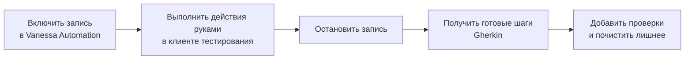

---
tags:
  - 1С/тестирование
---

> [!abstract] Коротко
> Сценарии Vanessa Automation собираются из **стандартных шагов** библиотеки: навигация, работа с полями и таблицами, кнопки, проверки окон, значений, таблиц и сообщений. Нужный шаг ищут через **поиск известных шагов** или получают **записью действий**: прокликали сценарий в клиенте тестирования — получили готовый текст. Значения можно **запомнить** в переменную и использовать дальше (`$НомерНакладной$`). Для бизнес-действий, которые повторяются во многих сценариях, пишут **свои шаги**: экспортную процедуру на встроенном языке или **экспортный сценарий**, который другие сценарии вызывают одной фразой. Без проверок («Тогда …») сценарий только «прокликивает» интерфейс, но ничего не тестирует.

## Из чего собирается сценарий

Почти любой UI-сценарий состоит из трёх видов шагов:

| Вид | Примеры | Доля в сценарии |
| --- | --- | --- |
| **Навигация** | Открыть раздел, создать документ, перейти на вкладку | Небольшая |
| **Ввод** | Выбрать значение в поле, ввести число, добавить строку таблицы, нажать кнопку | Основная |
| **Проверка** | Открылось окно, поле равно значению, таблица равна ожидаемой, есть сообщение | **Обязательная** |

> [!warning] Сценарий без проверок — не тест
> Если в сценарии нет шагов «Тогда …», он только прокликивает интерфейс. Такой сценарий «пройдёт», даже если сумма посчитана неверно. Каждое важное действие заканчивайте проверкой результата.

## Типичные стандартные шаги

Ниже — типичные формулировки шагов библиотеки Vanessa Automation. Точный текст в вашей версии проверяйте поиском известных шагов (о нём — ниже).

### Окна и навигация

| Шаг | Что делает |
| --- | --- |
| `Дано Я открыл новый сеанс TestClient или подключил уже существующий` | Подключиться к клиенту тестирования |
| `И я закрыл все окна клиентского приложения` | Закрыть все окна — чистый старт |
| `И В командном интерфейсе я выбираю 'Раздел' 'Команда'` | Открыть раздел и команду в панели разделов |
| `Тогда открылось окно 'Заголовок'` | Проверить, что активно окно с таким заголовком (`*` в конце — любое продолжение) |
| `И я закрываю текущее окно` | Закрыть активное окно |

### Кнопки и поля

| Шаг | Что делает |
| --- | --- |
| `И я нажимаю на кнопку с именем 'ФормаЗаписать'` | Нажать кнопку по имени элемента |
| `И я нажимаю на кнопку 'Записать'` | Нажать кнопку по заголовку |
| `И в поле с именем 'Комментарий' я ввожу текст 'Тест'` | Ввести текст в поле |
| `И из выпадающего списка с именем "Покупатель" я выбираю по строке 'Ромашка'` | Ввести строку и выбрать найденное значение |
| `И я перехожу к закладке с именем "СтраницаУслуги"` | Переключить вкладку |

### Таблицы

| Шаг | Что делает |
| --- | --- |
| `И в таблице "Товары" я нажимаю на кнопку с именем 'ТоварыДобавить'` | Добавить строку |
| `И в таблице "Товары" я активизирую поле с именем "ТоварыКоличество"` | Встать на ячейку |
| `И в таблице "Товары" в поле с именем 'ТоварыКоличество' я ввожу текст '2'` | Ввести значение в ячейку |
| `И в таблице "Товары" я завершаю редактирование строки` | Завершить ввод строки |
| `И в таблице "Товары" я перехожу к строке:` + таблица | Найти и выделить строку по значениям |

### Проверки

| Шаг | Что проверяет |
| --- | --- |
| `Тогда элемент формы с именем "ИтогТоваров" стал равен '300'` | Значение поля |
| `Тогда таблица "Товары" стала равной:` + таблица | Содержимое таблицы целиком |
| `Тогда таблица "Товары" содержит строки:` + таблица | Что в таблице **есть** такие строки (остальные не важны) |
| `Тогда в логе сообщений TestClient есть строка 'Текст'` | Появилось сообщение пользователю |
| `Тогда элемент формы с именем "Покупатель" стал недоступен` | Состояние элемента ([[04. Программирование управляемых форм/11. Видимость, доступность и ТолькоПросмотр|11. Доступность]]) |

> [!tip] «Стала равной» или «содержит строки»
> «Стала равной» строже: таблица должна совпасть **полностью**, включая количество строк. «Содержит строки» мягче: проверяет только нужные строки. Берите строгий вариант, когда важен весь результат, и мягкий — когда в таблице могут быть посторонние данные.

## Как найти нужный шаг

Запоминать сотни формулировок не нужно.

**Способ 1. Поиск известных шагов.** В Vanessa Automation есть окно поиска по библиотеке шагов: вводите ключевое слово («таблица», «поле», «кнопк») — видите список подходящих шагов с описанием, выбираете и вставляете в сценарий, заменяя параметры в кавычках на свои.

**Способ 2. Запись действий пользователя.** Самый быстрый путь для новичка:



1. Подключите клиент тестирования.
2. В VA включите **запись действий**.
3. В окне клиента выполните сценарий руками: откройте раздел, создайте накладную, заполните поля.
4. Остановите запись — VA сформирует текст шагов.
5. Обязательно **доработайте** запись: добавьте проверки «Тогда …» (запись фиксирует только действия), удалите случайные щелчки, замените заголовки на имена элементов там, где это надёжнее.

Запись экономит время на «механике», а думать над проверками всё равно приходится самому.

## Переменные: запомнить и использовать

Часто значение становится известным только во время прогона — например, **номер** только что записанного документа. Его можно запомнить и использовать дальше:

```gherkin
И я нажимаю на кнопку с именем 'ФормаЗаписать'
И я запоминаю значение поля с именем "Номер" как "НомерНакладной"
И я закрываю текущее окно

# Находим документ в списке по запомненному номеру
Тогда таблица "Список" содержит строки:
	| 'Номер'            |
	| '$НомерНакладной$' |
```

Запись `$ИмяПеременной$` подставляет запомненное значение. Это позволяет проверять результат работы, не зная данных заранее.

## Свои шаги

Стандартные шаги описывают **интерфейс**: кнопки, поля, таблицы. Но сценарий из десятков интерфейсных шагов тяжело читать, а одни и те же действия («создать накладную с товаром…») повторяются во многих сценариях. Поэтому создают **свои шаги** на языке бизнеса.

### Способ 1. Экспортный сценарий

Сценарий можно пометить меткой `@ExportScenarios` — тогда его **название** становится новым шагом, который можно вызывать из других сценариев:

```gherkin
#language: ru
@ExportScenarios
@IgnoreOnCIMainBuild

Функционал: Общие шаги для продаж

Сценарий: Я создаю расходную накладную для покупателя "Покупатель"
	Когда В командном интерфейсе я выбираю 'Торговый учёт' 'Расходные накладные'
	И я нажимаю на кнопку с именем 'ФормаСоздать'
	И из выпадающего списка с именем "Покупатель" я выбираю по строке '[Покупатель]'
```

Теперь в любом сценарии можно написать одну строку:

```gherkin
Дано Я создаю расходную накладную для покупателя "Ромашка"
```

Параметр в кавычках подставится вместо `[Покупатель]`. Метка `@IgnoreOnCIMainBuild` говорит: сам этот файл как тест не запускать — это библиотека шагов. Подробно о механизме — в документации VA.

### Способ 2. Шаг на встроенном языке

Для шагов, которые удобнее сделать кодом (быстро создать данные, проверить движения регистра), VA умеет сгенерировать **обработку-шаблон** к `.feature`-файлу: для каждого нереализованного шага создаётся экспортная процедура, в которую пишется код на встроенном языке. Например, шаг «в базе есть товар "Чайник"» может проверять справочник и при необходимости создавать элемент. Это мощно, но требует программирования — начинайте со стандартных и экспортных сценариев.

## Как сделать сценарий надёжным

| Правило | Почему |
| --- | --- |
| Ищите элементы по **имени**, а не по заголовку | Заголовки меняются |
| После каждого важного действия — проверка | Падение в месте причины |
| Начинайте с «закрыть все окна» | Независимость от прошлого состояния |
| Не полагайтесь на позицию строки («третья строка») | Порядок может измениться — ищите строку по значениям |
| Не используйте фиксированные паузы «подождать 5 секунд» | Медленно и ненадёжно; используйте шаги, которые ждут появления окна или значения |
| Один сценарий — одно поведение | Понятно, что именно сломалось |

> [!question]- Проверь себя
> 1. Какие три вида шагов составляют UI-сценарий и какой из них обязателен для того, чтобы сценарий был тестом?
> 2. Чем отличаются проверки «таблица стала равной» и «таблица содержит строки»?
> 3. Что нужно обязательно сделать после записи действий пользователя?
> 4. Как использовать номер документа, известный только во время прогона?
> 5. Зачем нужны экспортные сценарии?
>
> > [!success]- Ответы
> > 1. Навигация, ввод, проверка; без проверок сценарий ничего не тестирует.
> > 2. «Стала равной» требует полного совпадения таблицы; «содержит строки» — только наличия указанных строк.
> > 3. Добавить проверки «Тогда …», убрать лишние действия, при необходимости заменить заголовки на имена элементов.
> > 4. Запомнить его шагом «я запоминаю значение поля … как "Имя"» и подставлять как `$Имя$`.
> > 5. Чтобы повторяющиеся действия оформить одним бизнес-шагом и вызывать из многих сценариев.

%% навигация %%

---
← [[07. Тестирование 1С/11. Первый сценарий в Vanessa Automation|11. Первый сценарий в Vanessa Automation]] · [[07. Тестирование 1С/00. Навигация по разделу|↑ Раздел]] · [[00. Оглавление|⌂ Оглавление]] · [[07. Тестирование 1С/13. Тестовые данные и независимость сценариев|13. Тестовые данные и независимость сценариев]] →
