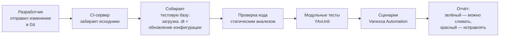

---
tags:
  - 1С/тестирование
---

> [!abstract] Коротко
> Автотесты окупаются, когда запускаются **регулярно и сами**: после каждого изменения или каждую ночь. Vanessa Automation запускается из командной строки: 1С:Предприятие в режиме менеджера тестирования открывает `vanessa-automation.epf` с параметром `/C"StartFeaturePlayer;VAParams=путь\VAParams.json"`; в файле **VAParams.json** — каталог сценариев, отбор по меткам, формирование отчётов (например, Allure или JUnit) и завершение работы после прогона. YAxUnit запускается параметром `/C RunUnitTests=…`. **CI** (непрерывная интеграция) — сервер, который при каждом изменении в Git собирает базу, запускает тесты и показывает отчёт. Регрессионный набор делят по меткам: быстрые дымовые — часто, полный — ночью.

## Зачем запускать тесты автоматически

Набор из 50 сценариев, который нужно запускать руками, со временем перестают запускать: «некогда, потом». А регрессия случается именно тогда, когда тесты не запускали ([[02. Основные понятия тестирования]]).

Поэтому тесты запускают **автоматически**:

| Когда | Что запускать | Зачем |
| --- | --- | --- |
| После каждого изменения (коммита) | Модульные тесты + дымовые сценарии `@smoke` | Быстро узнать, что ничего не сломано — за минуты |
| Каждую ночь | Полный регрессионный набор | Подробная проверка всего — время не важно |
| Перед выпуском обновления | Полный набор + приёмочные сценарии | Уверенность перед передачей пользователям |

## Запуск Vanessa Automation из командной строки

Для запуска без участия человека VA получает настройки из **файла профиля** `VAParams.json`.

### Команда запуска

```bash
"C:\Program Files\1cv8\<версия>\bin\1cv8c.exe" ENTERPRISE /IBName "Купец (тест)" /N "Тестировщик" /TESTMANAGER /Execute "C:\VA\vanessa-automation.epf" /C"StartFeaturePlayer;VAParams=C:\Tests\VAParams.json"
```

| Часть | Смысл |
| --- | --- |
| `1cv8c.exe ENTERPRISE` | Запустить 1С:Предприятие (тонкий клиент) |
| `/IBName "Купец (тест)"` | Имя базы из списка баз; вместо него можно указать `/F "путь к каталогу"` для файловой базы |
| `/N "Тестировщик"` | Пользователь |
| `/TESTMANAGER` | Режим менеджера тестирования ([[10. Vanessa Automation — установка и запуск]]) |
| `/Execute "…epf"` | Сразу открыть обработку Vanessa Automation |
| `/C"StartFeaturePlayer;VAParams=…"` | Параметр для VA: запустить выполнение сценариев с настройками из файла |

### Файл VAParams.json

Профиль — JSON-файл ([[02. Программирование/31. Файлы, JSON и временное хранилище|31. JSON]]) с настройками прогона. Состав параметров и их точные имена описаны в документации VA ([описание VAParams.json](https://pr-mex.github.io/vanessa-automation/dev/JsonParams/JsonParamsRU/)); удобнее всего **сохранить профиль из интерфейса** VA, настроив всё мышкой, а затем править файл.

Что обычно задают в профиле:

| Настройка | Зачем |
| --- | --- |
| Каталог с `.feature`-файлами | Что запускать |
| Выполнять сценарии сразу | Без нажатия кнопок |
| Отбор и исключение по **меткам** | Например, только `@smoke` или всё, кроме `@медленный` |
| Клиенты тестирования | К какой базе и под каким пользователем подключаться |
| Формировать отчёты и куда их сохранять | Отчёт о прогоне для людей и для CI |
| Сохранить итоговый статус в файл | Чтобы скрипт понял: прогон успешен или нет |
| Завершить работу после выполнения | Чтобы 1С закрылась сама |

## Отчёты о прогоне

После прогона нужно понять: что прошло, что упало и почему. VA умеет формировать отчёты в нескольких форматах:

| Формат | Для кого | Что даёт |
| --- | --- | --- |
| **Allure** | Люди | Наглядный веб-отчёт: графики, список сценариев, шаги, ошибки, снимки экрана в момент падения |
| **JUnit (XML)** | CI-системы | Стандартный формат, который понимают Jenkins, GitLab CI, TeamCity: число тестов, упавшие, время |
| Итоговый статус в файле | Скрипты | Одна строка — «успех / провал» — для решения, продолжать ли сборку |

> [!tip] Снимки экрана при падении
> Включите в профиле сохранение скриншота при ошибке. Красный шаг «не найден элемент формы» вместе со снимком окна в момент падения разбирается за минуту, без повторного прогона.

## Запуск YAxUnit без участия человека

Модульные тесты YAxUnit запускаются похожим образом — параметром `RunUnitTests` ([[08. Модульные тесты в YAxUnit]]):

```bash
"C:\Program Files\1cv8\<версия>\bin\1cv8c.exe" ENTERPRISE /IBName "Купец (тест)" /N "Тестировщик" /C RunUnitTests=C:\Tests\yaxunit-config.json
```

В файле настроек указывают, какие тестовые модули запускать и куда сохранить отчёт (в том числе в формате JUnit).

## Непрерывная интеграция (CI)

**CI** (Continuous Integration — непрерывная интеграция) — практика, при которой каждое изменение кода **автоматически** проверяется. Специальный сервер (Jenkins, GitLab CI, TeamCity и др.) следит за Git-репозиторием ([[05. Профессиональная разработка/10. Хранилище, EDT и Git|10. Git]]) и при каждом изменении запускает цепочку:



Результат виден прямо в запросе на слияние: «все проверки пройдены» или «упал сценарий такой-то». Изменение, которое ломает тесты, не попадает в основную ветку.

Настройка CI для 1С — отдельная инженерная задача (нужны агенты с установленной платформой, лицензии, скрипты сборки базы). От junior-разработчика обычно ждут не умения настроить конвейер с нуля, а:
- понимать, **что** проверяет конвейер и как читать его отчёт;
- уметь запустить тесты **локально**, прежде чем отправлять изменения;
- писать новые тесты к своим доработкам;
- не «чинить» упавший тест, удаляя проверку, а разбираться в причине.

## Как организовать регрессионный набор

| Метка | Что внутри | Когда запускается |
| --- | --- | --- |
| `@smoke` | 5–10 самых важных сценариев: открытие базы, создание и проведение ключевых документов | При каждом изменении |
| `@регрессия` | Все стабильные сценарии | Ночью |
| `@медленный` | Длинные сценарии (большие документы, отчёты за год) | Ночью или по отдельному расписанию |
| `@в_разработке` | Новые, ещё не стабильные | Исключаются из автоматического прогона |

Правило: **упавший тест — это задача**, а не «шум». Если тест падает из-за ошибки в самом тесте — исправляем тест. Если тест «мигает» — разбираемся с данными ([[13. Тестовые данные и независимость сценариев]]), а не отключаем его навсегда.

> [!question]- Проверь себя
> 1. Зачем запускать автотесты автоматически, а не вручную?
> 2. Что означают части команды запуска VA: `/TESTMANAGER`, `/Execute`, `/C"StartFeaturePlayer;VAParams=…"`?
> 3. Что обычно задают в VAParams.json?
> 4. Чем отличается отчёт Allure от отчёта JUnit?
> 5. Что такое CI и чего от junior-разработчика ожидают в работе с ним?
>
> > [!success]- Ответы
> > 1. Ручной запуск откладывают, и регрессия проходит незамеченной; автоматический запуск проверяет каждое изменение.
> > 2. Режим менеджера тестирования; сразу открыть обработку VA; передать VA команду запустить сценарии с профилем из файла.
> > 3. Каталог сценариев, автозапуск, отбор по меткам, клиентов тестирования, отчёты и путь к ним, запись итогового статуса, завершение работы.
> > 4. Allure — наглядный отчёт для людей (шаги, ошибки, скриншоты); JUnit — стандартный XML для CI-систем.
> > 5. Непрерывная интеграция: автоматическая сборка и проверка каждого изменения. От junior ждут понимать отчёт, запускать тесты локально, писать тесты к своим доработкам и разбираться с причинами падений.

%% навигация %%

---
← [[07. Тестирование 1С/13. Тестовые данные и независимость сценариев|13. Тестовые данные и независимость сценариев]] · [[07. Тестирование 1С/00. Навигация по разделу|↑ Раздел]] · [[00. Оглавление|⌂ Оглавление]] · [[07. Тестирование 1С/15. Практика — тестируем расходную накладную|15. Практика — тестируем расходную накладную]] →
